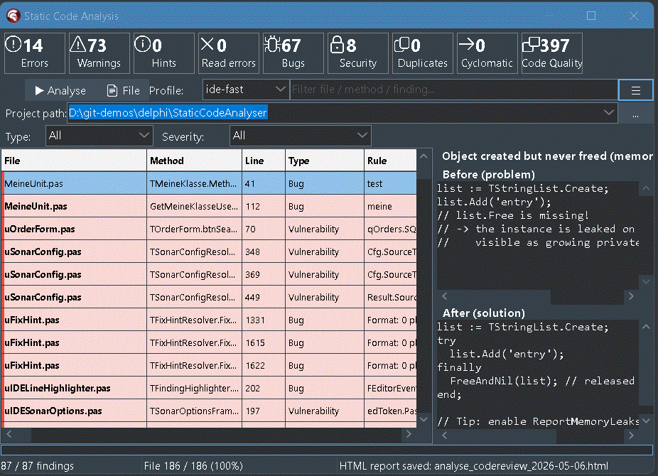
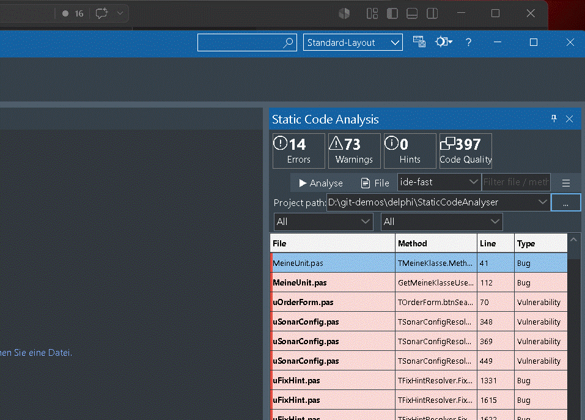
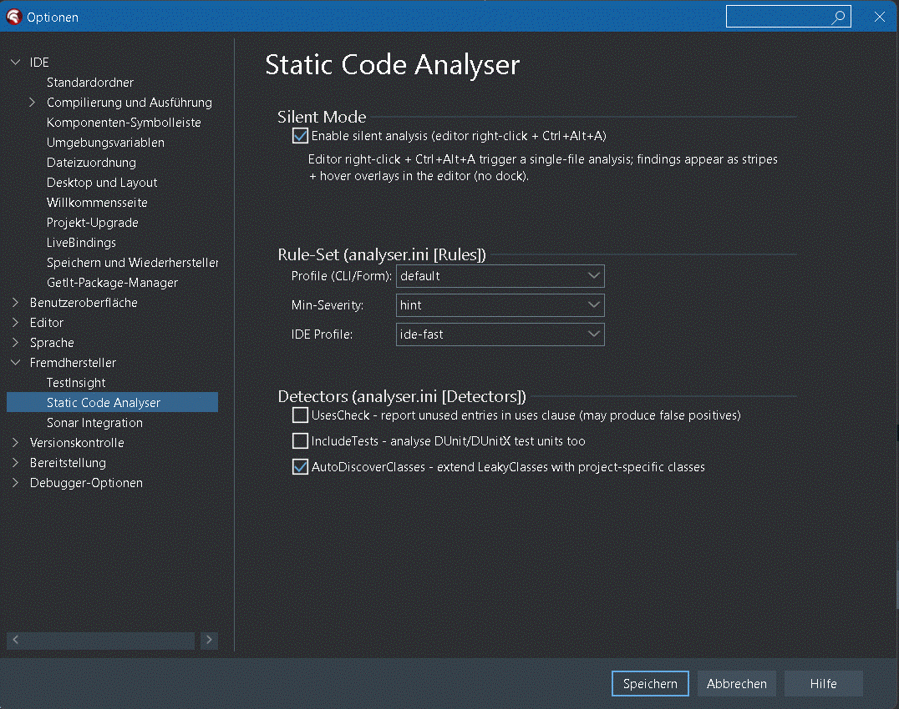

# Static Code Analysis Tool for Delphi and Lazarus / Free Pascal

[](https://paypal.me/nrodear)

[](LICENSE)
[](https://paypal.me/nrodear)

> Si ce plugin vous fait gagner du temps dans votre travail Delphi, un café est apprécié. 🙏

---

**Outil d'analyse statique de code Delphi** et **linter** pour **RAD Studio 12
(Athens)** et **13 (Florence)** — livré comme **plugin IDE** avec une fenêtre d'outil
ancrable plus une **application Windows autonome**. L'installateur dessert l'IDE
32 bits de Delphi 12 et les **deux** IDE de Delphi 13, 32 et 64 bits ; l'application
autonome existe en version 32 bits et 64 bits. Les projets **Lazarus / Free Pascal**
sont analysés nativement par l'application autonome et la CLI — même moteur, mêmes
règles, selon le dialecte : projets `.lpi`/`.lpk`, unités `.pp`/`.lpr` et fiches
`.lfm` ([détails](#lazarus--free-pascal-fpc)).
Analyse basée sur l'AST avec **207 règles** : 183 contrôles
Pascal pour les fuites mémoire, l'injection SQL, les code smells, les
vulnérabilités de sécurité, l'encodage des fichiers et la sûreté Unicode
(Trojan Source) et la duplication de code
(dont un sous-ensemble **compatible Sonar-Delphi** SCA060+), **plus un
scanner DFM dédié avec 23 contrôles** bâti sur ses propres lexeur + parseur DFM +
graphe de composants, appariés à l'AST Pascal — gestionnaires d'événements morts,
identifiants de base de données en clair dans les fichiers de fiche, câblage
maître-détail circulaire, champs obligatoires de dataset sans liaison UI, SQL
construit à partir de `TEdit.Text`, couplage entre fiches, et plus encore.
Classification de type Sonar avec un Quality Score. Index de fiches à l'échelle
du dépôt pour l'analyse inter-unités. Le mode diff VCS traite les changements
`.dfm` comme déclencheurs pour la `.pas` associée. Rapport HTML avec filtre
groupé `.pas`+`.dfm`. Le plugin IDE ouvre les résultats DFM comme texte
directement dans l'éditeur de code. Copie dans le presse-papiers d'un prompt de
correction Markdown prêt pour l'IA pour n'importe quel résultat (menu
contextuel ; la copie automatique au clic est opt-in). Open source, sous licence MIT.

🇬🇧 [English version](README.md) · 🇩🇪 [Deutsche Fassung](README_de.md)


---

## Ce que fait ce plugin

En une phrase : **une analyse de type Sonar pour les projets Delphi, sans
aucune installation Sonar, directement dans l'IDE, avec passage de relais à Claude AI.**

| Capacité | Détails |
|----------|---------|
| 🐛 **Détection de bugs** | 183 règles Pascal exécutées sur chaque fichier `.pas` (MemoryLeak, NilDeref, DivByZero, FormatMismatch, MissingRaise, RoutineResultUnassigned, CharToCharPointerCast, UnpairedLock, GetMemWithoutFreeMem, PointerArithmeticOnString, …) plus 23 règles DFM sur chaque `.dfm` (gestionnaires d'événements morts, identifiants de base de données en clair, maître-détail circulaire, composants inutilisés, …) et une règle pour les fichiers `.ini` — **207 au total**, portées par 163 enregistrements de pipeline |
| 🔐 **Contrôles de sécurité** | SQLInjection (basé sur un score), HardcodedSecret, HardcodedPath, HardcodedIpAddress (aussi dans les fichiers .ini) ; **sûreté Unicode** — Trojan Source / bidirectional override (CVE-2021-42574), caractères invisibles / à chasse nulle, intégrité BOM / encodage UTF-8 |
| 🧹 **Code smells** | LongMethod, MagicNumber, EmptyExcept, MissingFinally, DeadCode, DuplicateString/Block |
| ⚡ **Analyse incrémentale** | Bouton « Branch-Changes » : uniquement les fichiers modifiés dans la branche Git/SVN — 200 ms au lieu de 60 s |
| 🤖 **Prompt Claude AI** | Copy AI prompt (menu contextuel) → un bloc Markdown complet avec contexte de code + avant/après est copié dans le presse-papiers ; la copie au clic est opt-in via `[UI] ClipboardOnClick` |
| 📊 **Tableau de bord de type Sonar** | Tuiles de statistiques au-dessus de la grille : Erreurs / Avertissements / Conseils / Bugs / Vulnérabilités / Qualité du code en note **A–E** (style Sonar ; score brut + détail dans l'infobulle) |
| 🎯 **Filtrer et trier** | Liste déroulante de sévérité, liste déroulante de type, champ de recherche en direct, en-têtes de colonnes cliquables |
| 📤 **Export** | SARIF, Sonar Generic Issue, rapport HTML autonome, CSV, JSON et JSON de référence depuis la CLI et la GUI ; markup wiki Jira et remise au presse-papiers depuis la GUI — formats, flux de travail et limites dans [EXPORTS_fr.md](EXPORTS_fr.md) |
| 🔇 **Suppression** | `// noinspection MemoryLeak` par ligne, plus `ignore.txt` pour des fichiers entiers |
| 🌓 **Suivi du thème** | Suit automatiquement le thème actif de l'IDE (Light / Dark / Mountain Mist / Carbon) |
| 💡 **Aide avant/après** | Chaque détecteur possède une paire d'exemples de code « à ne pas faire / à faire » dans le panneau d'aide |
| 🔧 **Actions de code** | [reDelphix](#actions-de-code--redelphix), partie intégrante de SCA : quick-fixes sur les résultats et refactorisations dans l'éditeur, toujours installé avec le plugin IDE |

---

## Fonctions principales

### 1. Analyse statique de code (207 règles — 183 Pascal + 23 DFM + 1 INI, taxonomie Sonar)

**Contrôles AST Pascal (~160)** : **bugs** (MemoryLeak, NilDeref, DivByZero,
FormatMismatch, ReversedForRange, SelfAssignment, VirtualCallInCtor,
MissingRaise, RoutineResultUnassigned, ReRaiseException,
InstanceInvokedConstructor, CharToCharPointerCast, UnicodeToAnsiCast,
DateFormatSettings, IfThenShortCircuit, …), **vulnérabilités**
(SQLInjection, HardcodedSecret, DisabledTlsVerification),
**points chauds de sécurité** (HardcodedPath, HttpInsteadOfHttps), **code smells**
(LongMethod, MagicNumber, DeadCode, EmptyExcept, MissingFinally,
CastAndFree, NilComparison, InheritedMethodEmpty, RaisingRawException,
~60 contrôles de nommage/formatage compatibles SonarDelphi SCA060-SCA131, …)
et **duplication de code** (DuplicateString, DuplicateBlock).

**Contrôles DFM (23)** sur le lexeur + parseur de fichiers de fiche dédié +
graphe de composants, appariés à l'AST Pascal via le FormBinder :
gestionnaires d'événements morts, identifiants de base de données en clair
dans les fichiers de fiche, câblage maître-détail circulaire, champs
obligatoires de dataset sans liaison UI, SQL construit à partir de
`TEdit.Text`, couplage entre fiches, raccourcis clavier en double sur les
contrôles, chaînes Caption non traduites, et plus encore. Index de fiches à
l'échelle du dépôt pour l'analyse inter-unités.

Chaque résultat est livré avec une correction avant/après dans le panneau d'aide.

### 2. Analyse incrémentale liée au VCS (Git + SVN)

Épargnez-vous le scan complet du projet. **Un clic sur `Branch-Changes`**
suffit : l'analyseur demande à `git diff` (ou `svn status`) les fichiers
`.pas` touchés dans votre branche et n'exécute les détecteurs que sur eux.
**~200 ms au lieu de 60 s** pour une branche de fonctionnalité typique —
assez peu coûteux pour servir de garde-fou pre-commit. La configuration vit
dans `analyser.ini`. Tous les détails dans [BRANCH_CHANGES_fr.md](BRANCH_CHANGES_fr.md).

### 3. Passage de relais à l'IA (prompt Claude en un clic)

Clic droit sur une ligne de résultat, puis **Copy AI prompt** — le
presse-papiers se remplit d'un **prompt Markdown prêt à l'emploi** :
métadonnées du résultat, contexte de code (±5 lignes, avec un marqueur sur la
ligne fautive) et la correction avant/après. Collez-le dans Claude avec
**Ctrl+V** — l'IA a désormais tout ce qu'il faut pour proposer un correctif concret.

La copie *automatique* au simple clic sur une ligne est **désactivée par
défaut** et se règle via `[UI] ClipboardOnClick` dans `analyser.ini` : `1` =
ne pas toucher au presse-papiers (défaut), `2` = un mini-ticket Jira compact
(titre + 5 puces factuelles), `3` = le prompt Claude complet à chaque
clic. Rien ne quitte jamais votre machine — le texte ne va que dans le
presse-papiers local.

---

## Cas d'usage par mode de déploiement

Le même moteur d'analyse est livré sous **trois formes**, chacune taillée
pour un flux de travail différent. Choisissez selon votre poste du moment :

| Cas d'usage | Plugin IDE | EXE autonome (GUI) | CLI (même EXE) |
|---|:---:|:---:|:---:|
| **Revue en ligne pendant le codage** — voir les marqueurs Bug/Vuln à côté de la ligne que vous venez d'écrire | ✅ grille en direct + bande de 3 px dans l'éditeur + surimpression au survol | — | — |
| **Quick-Fix de la ligne courante** — appliquer une suggestion de correctif sur place | ✅ `Ctrl+Alt+F` ou ampoule, via [reDelphix](#actions-de-code--redelphix) | — | — |
| **Naviguer dans les résultats au clavier** | ✅ grille + touches fléchées, l'éditeur suit | grille + touches fléchées | — |
| **Supprimer un faux positif sur cette ligne** | ✅ `Ctrl+Alt+S` insère `// noinspection RuleName` | manuel | manuel |
| **Confier un résultat à Claude AI** — prompt Markdown avec contexte de code | ✅ menu contextuel → presse-papiers (ou clic de ligne opt-in) | ✅ menu contextuel → presse-papiers (ou clic de ligne opt-in) | — |
| **Modifications de branche uniquement** — analyser les fichiers touchés depuis `main` / le diff SVN courant | ✅ ☰ → Analyser les modifications de branche | ✅ bouton ⎇ | ✅ `--branch` ou `--diff <ref>` |
| **Analyser un projet hors de Delphi** (RAD non installé / machine batch) | — | ✅ choisir un dossier, cliquer sur **▶ Analyse** | ✅ `StaticCodeAnalyser.d12.exe --path <dossier>` |
| **Exécuter comme hook pre-commit** | — | — | ✅ `--min-severity error --quiet --fail-on error`, le code de sortie reflète la sévérité |
| **Exécuter en CI / GitHub Actions** | — | — | ✅ `--report-sarif sca.sarif`, étape d'upload SARIF |
| **Envoyer les résultats vers SonarQube / SonarCloud** (SCA écrit le fichier, `sonar-scanner` l'importe) | ✅ Export → Sonar | ✅ Export → Sonar | ✅ `--sonar-export sca-findings.json` — voir [EXPORTS_fr.md](EXPORTS_fr.md#workflow-3--tableau-de-bord-sonarqube) |
| **Générer un rapport HTML** pour les parties prenantes / pièces jointes Jira | ✅ Export → HTML | ✅ Export → HTML | ✅ `--report-html <fichier>` |
| **Export CSV / JSON** des résultats | ✅ menu Export | ✅ menu Export | ✅ `--report-csv <fichier>`, `--report-json <fichier>` |
| **Export Jira** des résultats | ✅ menu Export | ✅ menu Export | — (GUI uniquement) |
| **Scan nocturne du dépôt entier** + diff contre la référence | — | ✅ planifier via le Planificateur de tâches | ✅ planifier via `cron` / `schtasks` |
| **Analyse automatique à l'enregistrement** (Live-Watch) | ✅ opt-in, voir [Live-Watch](#live-watch-plugin-ide-uniquement--%EF%B8%8F-risqué) | — | — |
| **Créer / éditer des règles personnalisées** (fichier YAML, `[Detectors] CustomRulesFile`) | ✅ éditer `analyser.ini` | ✅ éditer `analyser.ini` | ✅ `--custom-rules <yml>` ou `analyser.ini` |
| **Configurer les seuils des détecteurs** (`LongMethodMaxBodyLines`, …) | ✅ Paramètres | ✅ Paramètres | éditer `analyser.ini` |
| **Changer la langue de l'interface** (EN / DE / FR) | ✅ Tools → Options | ✅ menu hamburger → Language | n/a (la CLI n'a pas de choix de langue) |
| **Choisir un profil de jeu de règles** (`ide-fast`, `default`, `strict`) | ✅ liste de profils | ✅ liste de profils | ✅ `--profile <nom>` |

### Quel déploiement pour quel rôle

**Développeur au clavier** → plugin IDE. Boucle de retour la plus courte :
marqueurs en ligne, saut à la ligne, Quick-Fix sur place avec reDelphix,
presse-papiers vers Claude. Le plugin partage la MÊME engine + le
même catalogue de règles + les mêmes FixHints que les deux autres. Les
chiffres peuvent malgré tout différer de la CI : le plugin démarre avec le
profil `ide-fast`, et les scans de projet diffèrent par conception (voir
[Périmètre d'analyse](#périmètre-danalyse--dossier-projet-ou-groupe-de-projets-cli)).

**Relecteur de code / Tech-Lead sans RAD Studio ouvert** → GUI autonome.
Même grille, mêmes filtres, même panneau d'aide que le plugin, mais
fonctionne sur un dossier de `.pas`+`.dfm` sans IDE en cours d'exécution.
Utile pour : revue sur une autre machine, batch nocturne sur un serveur de
build sans licence Delphi, remise de l'EXE à un ingénieur non-Delphi pour un
audit ponctuel.

**Pipeline CI / hook pre-commit / tâche planifiée** → mode CLI de la même
EXE. Pas de GUI, le code de sortie gradue le résultat et `--fail-on <level>`
fixe le seuil (0 = propre / sous le seuil ; les paliers figurent sous
[Intégration CI/CD](#intégration-cicd)). Exports disponibles en CLI : SARIF
(`--report-sarif <fichier>`) pour GitHub Code-Scanning / Azure Pipelines,
JSON Sonar Generic (`--sonar-export <fichier>`) pour les imports SonarQube,
un rapport HTML (`--report-html <fichier>`), CSV (`--report-csv <fichier>`)
et JSON (`--report-json <fichier>`). Le prompt IA et le texte Jira sont
GUI uniquement. Le filtre de modifications de branche (`--branch` pour la branche git courante contre
`main`, ou `--diff <ref>` pour une base arbitraire) permet aux builds de PR
de n'analyser que ce que le diff a touché.

**Les trois modes** lisent le même `analyser.ini`, le même
`rules/sca-rules.json`, les mêmes marqueurs de suppression, et émettent les
mêmes types de résultats. Passer de l'un à l'autre est gratuit — un résultat
supprimé dans l'IDE reste supprimé en CI.

---

## Démarrage rapide

1. **Installer** le plugin — deux voies, dans l'ordre recommandé :
   - **EXE d'installation** (recommandé) : télécharger
     `StaticCodeAnalyserSetup-<Version>.exe` depuis les releases GitHub et
     l'exécuter. Installation par utilisateur, aucun droit administrateur
     requis.

     Le setup demande **dans quels IDE** installer et n'affiche que ceux
     qu'il trouve réellement sur la machine :

     | | installe dans | enregistre sous |
     |---|---|---|
     | Delphi 12 (IDE 32 bits) | `bpl\d12` | `BDS\23.0\Known Packages` |
     | Delphi 13 (IDE 32 bits) | `bpl\d13` | `BDS\37.0\Known Packages` |
     | Delphi 13 (IDE 64 bits) | `bpl\d13x64` | `BDS\37.0\Known Packages x64` |

     Seules les cases cochées sont installées, et décocher une version
     déjà installée la supprime — fichiers, enregistrement et entrée PATH.
     Chaque IDE coché reçoit le plugin, ses deux paquets d'exécution et
     [reDelphix](#actions-de-code--redelphix), toujours installé avec
     le plugin. Pour que l'IDE trouve les paquets
     d'exécution, le setup place son dossier en tête du réglage PATH de l'IDE
     (**Tools > Options > IDE > Environment Variables**) ; les entrées
     existantes restent, et la désinstallation ne retire que ce dossier. Le
     setup vérifie aussi qu'aucun IDE Delphi ne tourne, nettoie les
     enregistrements conflictuels du jeu de paquets de développement,
     propose un choix de langue allemand/anglais, affiche la page de
     licence MIT et crée une entrée de désinstallation dans le menu
     Démarrer.

     **Mise à jour depuis la 0.9.18 :** lancer le nouveau setup. Il retire
     l'ancien plugin à BPL unique (`StaticCodeAnalyser.Plugin.d12`) de tous
     les IDE, y compris celui installé via GetIt, et le signale.
   - **Compilation maison** : ouvrir `StaticCodeAnalyser.d12.groupproj` et
     compiler les paquets un par un, dans cet ordre : `SCA.Engine`,
     `SCA.SharedUI`, `StaticCodeAnalyser.IDE.d12`, `reDelphix.d12`
     (clic droit → **Build**). Pas « Build All » : le groupe contient aussi
     des projets de test qui exigent DUnitX. Compiler les
     quatre pour la plateforme de l'IDE ; Delphi 12 n'a qu'un IDE 32 bits,
     donc **Win32** (en Win64, le plugin s'arrête sous Delphi 12 sur un
     `F1054` voulu). Ensuite installer `StaticCodeAnalyser.IDE.d12` et
     `reDelphix.d12` (clic droit → **Install**), jamais `SCA.Engine` ni
     `SCA.SharedUI`. Sans l'étape d'installation, le plugin compile mais
     n'apparaît jamais dans le menu de l'IDE. Instructions complètes dans
     [HowTo_Build_fr.md](HowTo_Build_fr.md), section 5.

   **GetIt** est suspendu pour la 0.9.19 : le jeu de paquets ne peut pas
   s'installer via GetIt. Si vous utilisez GetIt, prenez le setup.
2. Dans Delphi : **View → Static Code Analysis** — la fenêtre ancrable
   apparaît.
3. Choisir un chemin de projet → cliquer sur **▶ Analyse**.

Pour des scans incrémentaux limités aux fichiers modifiés dans la branche,
voir [BRANCH_CHANGES_fr.md](BRANCH_CHANGES_fr.md).

---

## Ce que contient une release

Chaque release sur la [page des releases](https://github.com/nrodear/StaticCodeAnalyser/releases)
fournit cinq artefacts :

| Artefact | De quoi il s'agit |
|---|---|
| `StaticCodeAnalyserSetup-<V>.exe` | **Installateur du plugin IDE.** Par utilisateur, sans droits administrateur. Choisit les IDE cibles parmi ceux qu'il détecte — Delphi 12 (32 bits) ainsi que Delphi 13 (32 et 64 bits) — et apporte reDelphix. |
| `StaticCodeAnalyser-v<V>-Win32.zip` | **EXE autonome, 32 bits**, avec le catalogue de règles. Réserve de pile portée à 32 Mo — nécessaire pour les arbres syntaxiques profonds des gros dépôts. |
| `StaticCodeAnalyser-v<V>-Win64.zip` | **EXE autonome, 64 bits.** Le bon choix pour les gros corpus ; l'espace d'adressage y est la limite déterminante. |
| `StaticCodeAnalyser-v<V>-source.zip` | **Sources** à l'état du tag de release. |
| `StaticCodeAnalyser-v<V>-docs-scripts.zip` | **Documentation et exemples CI** — tous les guides en français, anglais et allemand, plus `examples/` (workflow GitHub Actions avec envoi SARIF, hook pre-commit, bot de commentaires PR, cible MSBuild, profils d'analyse). |

Le plugin et l'EXE autonome partagent le même moteur et le même
catalogue de règles ; seule la façon de les piloter diffère.

---

## Actions de code : reDelphix

**reDelphix** est la fonction de SCA qui ajoute des actions de code au
plugin IDE, sous forme de paquet de conception distinct.
Sur un résultat, il propose des quick-fixes — pour
97 des 207 règles, par exemple `FreeAndNil(X)`, `try/finally` autour d'une
libération ou `Format()` à la place d'une concaténation — via une ampoule
sur la ligne du curseur, le menu contextuel du résultat (éditeur et grille
des résultats) et `Ctrl+Alt+F` dans la grille. Sans résultat, le menu
contextuel de l'éditeur propose des refactorisations au curseur, comme
inverser un `if`. Chaque action vérifie d'abord le tampon courant de
l'éditeur et n'écrit que dans l'éditeur, en une seule étape d'annulation,
jamais dans un fichier. Une action qui modifie le comportement le dit dans
son texte de menu et ne passe jamais par `Ctrl+Alt+F`.

**Le setup l'installe.** reDelphix fait partie du plugin IDE : chaque IDE
que le setup dessert le reçoit, y compris l'IDE 64 bits de Delphi 13, et
il ne peut pas être décoché. Les ZIP ne le contiennent pas.

On peut aussi le compiler depuis les sources. Il faut pour cela le jeu de
paquets de développement (`SCA.Engine`, `SCA.SharedUI`,
`StaticCodeAnalyser.IDE.d12`), car reDelphix est lié à `SCA.Engine`.
Retirez d'abord une installation par le setup pour cet IDE.

Les étapes figurent dans [HowTo_Build_fr.md](HowTo_Build_fr.md#53-installer-redelphix-actions-de-code).
Une compilation personnelle fonctionne aussi sans ce paquet : `Ctrl+Alt+F`
signale alors qu'il n'est pas chargé, `Ctrl+Alt+S` insère toujours le
marqueur de suppression.

Chaque action avec ses textes de menu, son effet, ses blocages et un
exemple : [reDelphix/QUICKFIXES.md](reDelphix/QUICKFIXES.md). Notes de
développement : [reDelphix/README.md](reDelphix/README.md). Les deux sont
en allemand.

---

## Intégration Sonar

Les résultats SCA peuvent être exportés comme **external issues** vers
SonarQube / SonarCloud (complémentaire de [SonarDelphi](https://github.com/integrated-application-development/sonar-delphi)
— nos résultats connaissent mORMot, couvrent les fichiers DFM et apportent
des contrôles étrangers à Sonar comme `TautologicalBoolExpr`,
`ConcatToFormat`, `WithStatement`).

> **Testé avec** : SonarQube Community Build 26.5+ (Sonar 10+, mode MQR).
> Les résultats SCA s'importent comme external issues via le Generic Issue
> Format et coexistent avec le profil par défaut intégré de Sonar
> (**Sonar Way**) — aucun conflit, aucun écrasement. Fonctionne aussi bien
> avec SonarQube Server qu'avec SonarCloud.

```powershell
# Lancer l'analyse et produire le Generic Issue Format pour sonar-scanner
StaticCodeAnalyser.d12.exe --path . --sonar-export sca.json --profile default
sonar-scanner   # le lit via sonar.externalIssuesReportPaths
```

Chaque règle porte les champs MQR de SonarQube (`cleanCodeAttribute` +
`impacts`), de sorte que les résultats apparaissent correctement dans le
tableau de bord MQR.

SCA écrit seulement le fichier. Guide rapide : [sonarHowto_fr.md](sonarHowto_fr.md) ;
le serveur, le scanner et les jetons relèvent de la documentation officielle de Sonar.

---

## Ce qui est détecté (207 règles — 183 Pascal + 23 DFM + 1 INI)

Chaque résultat tombe dans l'une des **cinq catégories Sonar** :

| Catégorie | Détecteur | Sévérité |
|-----------|-----------|----------|
| **Bug** | `MemoryLeak` (LeakDetector + FieldLeak) | Erreur / Avertissement |
| | `NilDeref` (déréférencement de nil) | Avertissement |
| | `DivByZero` (division par zéro) | Erreur / Avertissement |
| | `FormatMismatch` (format contre nombre d'arguments) | Erreur |
| **Vulnerability** | `SQLInjection` (basé sur un score) | Erreur |
| | `HardcodedSecret` (clés d'API, mots de passe) | Erreur |
| **Security Hotspot** | `HardcodedPath` (`C:\…`, `/etc/…`) | Avertissement |
| **Code Smell** | `EmptyExcept` (exception avalée en silence) | Avertissement |
| | `MissingFinally` (Free hors d'un finally) | Avertissement |
| | `DeadCode` (inatteignable après exit/raise) | Avertissement |
| | `UnusedUses` (optionnel, désactivé par défaut) | Conseil |
| | `LongMethod`, `LongParamList` | Conseil |
| | `MagicNumber` (dans les conditions if) | Conseil |
| | `DebugOutput` (`OutputDebugString`, etc.) | Avertissement |
| | `DeepNesting` | Conseil |
| | `TodoComment` (TODO/FIXME/HACK) | Conseil |
| | `EmptyMethod` | Conseil |
| **Code Duplication** | `DuplicateString` (même littéral, ≥3 occurrences) | Conseil |
| | `DuplicateBlock` (≥ `DuplicateBlockMinLines`, par défaut 8 lignes identiques) | Conseil |
| **Erreur de lecture** | `FileReadError` (parseur bloqué ou fichier trop gros) | Erreur |

Chaque détecteur vient avec un **exemple de code avant/après** dans le
panneau d'aide. **Copy AI prompt** (menu contextuel) copie dans le
presse-papiers un **bloc Markdown prêt pour Claude AI** ; la copie
automatique au clic sur une ligne est opt-in via `[UI] ClipboardOnClick`
(désactivée par défaut).

Pour les **23 détecteurs spécifiques aux DFM** (DFM-DeadEventHandler,
DFM-HardcodedDBCredentials, DFM-CircularMasterDetail,
DFM-MissingRequiredFieldBinding, DFM-SQLFromTEditText, …) et leurs
astuces de correction : voir [DETECTORS_fr.md](DETECTORS_fr.md).

Statut complet des 50 règles Sonar : voir [DETECTORS_fr.md](DETECTORS_fr.md).

---

## Utilisation

### Barre d'outils et menu ☰

Le sélecteur de dossier (`...`) se trouve à droite au bout de la ligne du
chemin. La barre d'outils, de gauche à droite :

| Bouton | Plugin IDE | EXE autonome | Fonction |
|--------|:---:|:---:|----------|
| **▶ Analyse** | ✅ | ✅ | Scan récursif — ce qui est analysé (dossier / projet / groupe) est indiqué dans l'infobulle du bouton |
| **📄 File** | ✅ | ✅ | Plugin : le fichier `.pas` actuellement ouvert dans l'éditeur. EXE : un fichier `.pas` choisi dans une boîte de dialogue |
| **⊘** | ✅ | — | Effacer les marqueurs de l'éditeur dans tous les fichiers (la grille reste) |
| **⎇** | — | ✅ | Branch-Changes : uniquement les fichiers modifiés dans Git/SVN (voir [BRANCH_CHANGES_fr.md](BRANCH_CHANGES_fr.md)) |
| **Profil** | ✅ | ✅ | Profil de jeu de règles pour la prochaine exécution (voir _Filtres_ plus bas) |
| **☰** | ✅ | ✅ | Ouvre le menu ci-dessous |

Tout le reste se trouve dans le **menu ☰** :

| Entrée de menu | Plugin IDE | EXE autonome | Fonction |
|----------------|:---:|:---:|----------|
| **Analyser les modifications de branche** | ✅ | — (bouton ⎇) | Uniquement les fichiers modifiés dans Git/SVN (voir [BRANCH_CHANGES_fr.md](BRANCH_CHANGES_fr.md)) |
| **Annuler l'analyse** | ✅ | ✅ | Interrompt une analyse en cours ; pendant le scan, l'EXE affiche en plus un bouton **Annuler** dans la barre d'état |
| **Effacer tous les marqueurs**, **Réinitialiser tous les résultats** | ✅ | — | Retirer les marqueurs de l'éditeur ; la réinitialisation vide en plus les grilles |
| **Exporter...** | ✅ | ✅ | Formats d'export, voir _Export_ plus bas |
| **Écrire la référence à partir de l’analyse actuelle...**, **Afficher uniquement les nouveaux résultats (référence)** | ✅ | ✅ | Écrire une référence, n'afficher que les résultats qui n'y figurent pas |
| **Paramètres...** | ✅ | ✅ | Ouvrir `analyser.ini` — réglages VCS, LeakyClasses personnalisées (voir [BRANCH_CHANGES_fr.md](BRANCH_CHANGES_fr.md)) |
| **Liste d'exclusions...** | ✅ | ✅ | Ouvrir `ignore.txt` — liste d'exclusions de fichiers/dossiers |
| **Profils de jeu de règles ...** | ✅ | ✅ | Afficher les profils fournis |
| **Apparence**, **Ouvrir les résultats avec**, **Langue** | — | ✅ | Thème, cible à l'ouverture des résultats, langue de l'interface ; dans le plugin, l'IDE les fournit |



### Ouvrir un résultat

Double-cliquez sur une ligne de la grille de résultats. Ce qui se passe
ensuite dépend de `[Editor]` dans `analyser.ini` — relu à chaque
double-clic, les modifications prennent donc effet immédiatement.

| Clé `[Editor]` | Signification |
|----------------|---------------|
| `ExternalEditor` | Chemin complet vers un éditeur. S'il est défini, il prend en charge **tous** les types de fichiers — y compris `.dfm` — et l'IDE Delphi n'est plus sollicité. Vide (défaut) = désactivé. |
| `ExternalEditorArgs` | Modèle d'arguments. Marqueurs : `%file%`, `%line%`, `%col%`, `%dir%`, et `%%` pour un signe pourcent littéral. Tout le reste entre signes pourcent est laissé tel quel. |
| `DfmTarget` | `ide` (défaut) ou `viewer` — ce qu'ouvre un résultat `.dfm` **quand aucun éditeur externe n'est défini**. |

```ini
[Editor]
; Visual Studio Code
ExternalEditor=C:\Program Files\Microsoft VS Code\Code.exe
ExternalEditorArgs=-g "%file%:%line%"
```

Des modèles pour d'autres éditeurs sont listés dans `analyser.ini` même
(Notepad++, Sublime Text, UltraEdit, IntelliJ/Rider). Les valeurs contenant
une espace sont mises entre guillemets automatiquement quand le marqueur
n'est pas déjà entre guillemets — un modèle sans guillemets fonctionne donc
quand même.

**Pourquoi vouloir un éditeur externe.** L'EXE autonome ne peut pas
demander à l'IDE Delphi de sauter à une ligne — RAD Studio n'expose aucune
option de ligne de commande pour cela. Elle remet le fichier au shell
Windows puis simule <kbd>Ctrl</kbd>+<kbd>G</kbd> suivi des chiffres, ce qui
ne fonctionne que tant que l'IDE tient réellement le premier plan. Un
éditeur qui accepte le numéro de ligne en argument touche toujours sa
cible. (Le **plugin IDE** n'a pas ce problème : il navigue directement via
la ToolsAPI et ignore entièrement ces réglages.)

**Résultats `.dfm`.** L'IDE ouvre une `.dfm` dans le concepteur de fiches
selon la façon dont l'extension est enregistrée, et là aucun chemin ne mène
à un numéro de ligne. La visionneuse intégrée affiche le fichier comme
texte et atteint la ligne de façon fiable, mais elle est en lecture seule.
Choisissez avec `DfmTarget`, ou depuis le menu hamburger sous **Ouvrir
les résultats avec**. Si aucun gestionnaire ne répond, la visionneuse est
utilisée de toute façon.

### Configuration par détecteur

Il n'y a pas de cases à cocher dans la barre d'outils. Tout comportement
optionnel des détecteurs se configure via `analyser.ini` (voir _Fichiers de
configuration_ plus bas) — ouvrez-le via **☰ → Paramètres...**, éditez,
enregistrez, cliquez à nouveau sur **▶ Analyse**. Les réglages sont
rechargés à chaque exécution, aucun redémarrage de l'IDE n'est nécessaire.

### Cartes de statistiques

Une rangée de tuiles au-dessus de la grille compte les résultats de la
dernière exécution :

- **Erreurs / Avertissements / Conseils / Erreurs de lecture** : par
  sévérité. Une erreur de lecture ne compte que sous Erreurs de lecture.
- **Bogues / Sécurité / Doublons** : par type — Bug, Vulnerability, Code
  Duplication. Les code smells et les security hotspots n'ont pas de
  tuile propre ; ils comptent dans les tuiles de sévérité et dans le
  Quality Score.
- **Complexité** : résultats de la règle de complexité de McCabe
  (SCA022), comptés en plus de leur sévérité.

Un clic sur une tuile filtre la grille sur ce groupe ; un clic sur la
tuile Qualité réinitialise tous les filtres. Dans une fenêtre de plugin
étroite, seules Erreurs, Avertissements, Conseils et Qualité restent
visibles.

Une **tuile Quality Score** à côté d'elles montre la qualité du code en
note **A–E** (style Sonar) ; le score brut et son détail apparaissent dans
l'infobulle de la tuile.

### Filtres

- **Listes déroulantes sévérité / type** : restreignent la grille à une seule catégorie.
- **Liste déroulante de profil** : change le jeu de règles actif à la
  volée. Profils fournis : `ide-fast` (défaut de l'IDE — bugs + vulns
  uniquement), `default` (tout sauf les huit règles de pure convention),
  `strict` (vraiment tout ; SCA007 seulement avec
  `[Detectors] UsesCheck=1`, contrairement à la CLI), `style` (exactement ces huit), `security`
  (vulns + hotspots uniquement), `bugs-only`, `code-quality`, `dfm-only`.
  Les profils vivent dans `rules/sca-rules.json` sous `profiles` et la
  liste déroulante s'en nourrit — déposez votre propre profil dans le JSON
  et il apparaît. La sélection est persistée dans `[Rules] IdeProfile` et
  prend effet à la prochaine exécution de l'analyse.
- **Champ de recherche** (`Filtrer fichier / méthode / résultat`) : filtre
  en direct sur toutes les colonnes.

### Interaction avec la grille

| Action | Effet |
|--------|-------|
| **Clic sur une ligne** | Affiche le résultat dans le panneau d'aide ; si le fichier est ouvert dans l'IDE, une bande de 3 px est peinte au bord gauche de la ligne correspondante dans l'éditeur. Ce qui atterrit dans le presse-papiers est contrôlé par `[UI] ClipboardOnClick` : `1` = rien (défaut), `2` = mini-ticket Jira, `3` = prompt Markdown pour Claude AI. |
| **Clic droit → Copy AI prompt** | Copie le prompt Markdown Claude AI — toujours, quel que soit `ClipboardOnClick`. |
| **Double-clic / Entrée** | Ouvre le fichier dans l'IDE, saute à la ligne du résultat, peint le marqueur de ligne |
| **Ctrl+Alt+F** | **Appliquer l'aide d'édition** du résultat — la première aide disponible du package reDelphix, la même que propose l'ampoule (sur place via IOTAEditWriter après vérification du tampon, une seule étape Ctrl+Z). Les aides marquées « (modifie le comportement) » ne s'exécutent que depuis le menu ou l'ampoule. Nécessite reDelphix ; la barre d'état rapporte le résultat ou la raison de l'absence d'aide. |
| **Ctrl+Alt+S** | **Insérer le marqueur de suppression** au-dessus de la ligne du résultat : `// noinspection <RuleName>` (reDelphix ajoute la règle à un marqueur existant). La prochaine analyse filtre le résultat. Ctrl+Z pour revenir en arrière. |
| **Touches fléchées, Page préc./suiv., Début/Fin** | Se déplacent dans la grille ; dès que la sélection s'arrête, l'éditeur saute au résultat |
| **Survol (colonne fichier)** | Infobulle avec le chemin complet du fichier (délai de 100 ms) |
| **Clic sur un en-tête de colonne** | Trie selon cette colonne |
| **Bande de 3 px au bord gauche** de la ligne de grille | Accent de sévérité (rouge / orange / vert / bleu) |

Le **panneau d'aide** à droite, avec les blocs de code avant/après, n'est
affiché que lorsque la fenêtre du plugin IDE est **flottante** — une fois
ancrée dans une barre latérale ou un onglet, le panneau se masque et la
grille prend toute la largeur (il réapparaît en ~250 ms après le désancrage).



### Export

**☰ → Exporter...** ouvre ces entrées :

| Entrée | Format | Contenu |
|--------|--------|---------|
| **JSON** | `.json` | La vue filtrée de la grille sous forme de tableau (la légende du menu le dit) |
| **CSV** | `.csv` | Compatible Excel (séparé par des points-virgules) |
| **Rapport HTML** | `.html` | Rapport d'atelier autonome — recherche, filtres, palmarès, colonnes triables, panneau latéral avec l'extrait de code source et la documentation de la règle. Nom de fichier proposé : `sca_codereview_AAAA-MM-JJ.html`. Voir ci-dessous |
| **SARIF** | `.sarif` | Tous les résultats, pour GitHub Code Scanning et d'autres lecteurs SARIF |
| **Sonar** | `.json` | Tous les résultats sous forme de rapport Sonar Generic Issue pour `sonar-scanner` |
| **Detector info** | `.html` | Le catalogue de règles sous forme de page HTML |
| **Jira** | Presse-papiers | Markup wiki prêt à coller dans un ticket Jira (filtré sur un fichier) |
| **Clipboard** | Presse-papiers | Texte brut avec avant/après (filtré sur un fichier) |

#### Le rapport HTML

Un seul au lieu d'une famille grandissante : à côté du rapport HTML
d'origine, le menu avait gagné un second rapport basé sur l'atelier —
et une troisième variante a brièvement existé pendant le développement.
Depuis le 2026-09-09, l'interface n'en livre qu'un : le **rapport
d'atelier**.

Il s'ouvre sur la note de santé, les tuiles de statistiques et deux
palmarès (« où ça fait mal ? »), puis la recherche, les listes
déroulantes fichier et règle, et les pastilles type / sévérité /
confiance. Un clic sur un résultat ouvre un **panneau latéral** avec
l'extrait de code, l'emplacement et la documentation de cette règle
précise, y compris les actions de code reDelphix de la règle (voir
[plus haut](#actions-de-code--redelphix)). L'en-tête de page, la barre de filtres et la ligne d'en-têtes
de colonnes s'épinglent l'une sous l'autre pendant le défilement : on
voit donc toujours selon quoi on filtre et quelle colonne on lit.

Il est **autonome** : aucun fichier externe, aucun CDN, rien ne quitte
la machine. Il s'ouvre depuis un partage réseau ou un artefact de CI.

À cette échelle la taille compte, et trois choses la contiennent : la
documentation de règle est stockée **une fois par règle** au lieu d'une
fois par résultat, l'extrait de code est stocké en texte brut et n'est
construit qu'à l'ouverture du panneau, et le texte de recherche est lu
dans la ligne au lieu d'être écrit une seconde fois. Au total, cela
représente environ la moitié de ce que pesait le même rapport.

> Le `--report-html` de la CLI est un **autre** rapport — voir
> [EXPORTS_fr.md](EXPORTS_fr.md).

### Panneau File-Findings (ancrage par fichier)

Une deuxième fenêtre ancrable qui se concentre sur le **fichier actuellement
actif dans l'éditeur**. S'ouvre via **View → Static Code Analysis - File**.
Conçue pour un ancrage latéral à côté de l'éditeur, afin de toujours voir
les résultats du fichier sur lequel vous travaillez.

| Propriété | Comportement |
|---|---|
| **Déclencheur** | Analyse automatiquement le fichier actif à l'ouverture et à chaque changement d'onglet. Aucun clic « fichier courant » nécessaire |
| **Mise à jour en direct** | Si le mode watch est actif, les déclencheurs save/edit réalimentent aussi le panneau |
| **Colonnes de la grille** | Method / Line / Type / Rule / Severity (Rule s'étire ; barre d'accent de sévérité à gauche de chaque ligne) |
| **Filtre** | Liste avec *All severities* / *Errors only* / *Errors + Warnings* |
| **Tri** | Clic sur un en-tête de colonne pour trier (bascule croissant/décroissant) |
| **Clic sur une ligne** | Saute à la ligne du résultat dans l'éditeur (navigation douce, ne ferme/rouvre pas le fichier) |
| **.pas + .dfm** | Traités comme une seule cible d'analyse — basculer d'onglet entre les deux garde les résultats visibles |
| **Mémoire de position** | Se rouvre à la dernière position (persistée en session via `analyser.ini`, entre sessions via IDE Save Desktop). Repli : centré sur la fenêtre principale de l'IDE quand rien n'est stocké ou que la position est hors écran |
| **Thème + police** | Suit le thème actif de l'IDE (clair/sombre/personnalisé) et la police du plugin (Segoe UI 8) |

---

## Langue / localisation

La langue source de l'interface est l'**anglais** ; l'allemand et le
français sont fournis. Les chaînes de l'UI sont enveloppées dans `_('…')`
de `uLocalization.pas`, qui les cherche dans les traductions `.po` avec un
petit parseur maison. Il n'y a aucune bibliothèque externe, et les
traductions sont compilées dans le binaire : même une copie nue de l'EXE
affiche l'allemand ou le français.

### Changer de langue

| Où | Comment |
|----|---------|
| **Plugin IDE** | **Tools → Options → Third Party → Static Code Analyser** |
| **EXE autonome** | Menu hamburger → **Language**. La ligne de filtres, la ligne de chemin, l'en-tête de la grille et le bouton Analyse changent aussitôt, les autres libellés après un redémarrage |
| **`analyser.ini`** | `[UI] Language` = `en`, `de` ou `fr`. Vide ou inconnu signifie anglais ; les paramètres régionaux du système ne sont pas lus |

### Où vivent les traductions

| Chemin | Rôle |
|--------|------|
| `i18n/template.pot` | Modèle de la langue source (anglais) |
| `i18n/de.po` | Traduction allemande |
| `i18n/fr.po` | Traduction française |
| `i18n/en.po` | Base anglaise (identité) |
| `SCA.Engine/sources/Common/uLocalizationPo.inc` | Copie compilée, générée à partir des fichiers `.po` |

Les fichiers `.po` sont du texte brut, adaptés à Git ; éditez-les avec
[poEdit](https://poedit.net/) ou un éditeur ordinaire. Un `.po` dans un
dossier `i18n\` à côté de l'EXE ou du BPL a priorité sur la copie compilée,
ce qui permet d'essayer une traduction sans recompiler.

Les traductions elles-mêmes sont les fichiers `.po` sous
[i18n/](i18n/) — c'est l'unique source. Après en avoir modifié un, lancez
`python tools/gen_po_inc.py` pour régénérer la copie compilée, puis faites
un **Clean + Build** : l'IDE ne suit pas les dépendances `.inc` de façon
fiable et lierait sinon le texte précédent.

---

## Intégration du thème

### EXE autonome : clair / sombre

L'EXE suit par défaut le **thème d'application Windows** et peut être
épinglée via le menu hamburger sous **Appearance** (*Comme Windows* /
*Clair* / *Sombre*) ou dans `analyser.ini` :

```ini
[UI]
; system = suivre Windows (défaut), light, dark
Theme=system
```

Chaque clé de `analyser.ini` - seuils, profils, référence, interface - est
listée avec sa valeur par défaut dans la
[référence de configuration](docs/configuration_fr.md). Les règles que
contient réellement un profil - et comment écrire le sien - sont dans le
[guide des profils d'analyse](docs/profiles_fr.md).

Le style sombre est embarqué dans l'EXE — aucune option de projet VCL-Style
impliquée. En mode `system`, un changement de thème Windows prend effet
immédiatement (l'EXE écoute le broadcast) ; aucun redémarrage nécessaire.
Le menu écrit exactement la même clé INI, le réglage peut donc aussi être
déployé en distribuant `analyser.ini`.

### Tri de la grille de résultats (EXE)

Cliquez sur un en-tête de colonne pour trier ; cliquez à nouveau pour
inverser. La flèche dans l'en-tête montre la colonne active et le sens.
*Severity* trie par rang (Error > Warning > Hint), pas alphabétiquement. Un
double-clic sur la ligne d'en-tête ne fait que basculer deux fois — il
n'ouvre jamais un résultat.

### Plugin IDE

Le plugin suit le thème actif de l'IDE Delphi par plusieurs mécanismes :

- **`StyleServices.GetSystemColor`** dans le dessin personnalisé (OnDrawCell, TTilePanel.Paint)
- **`clBtnFace` / `clWindow` / `clBtnText`** comme valeurs de propriétés (thémées automatiquement via VCL Styles)
- **`IOTAIDEThemingServices.ApplyTheme`** lorsque le frame est hébergé
- **`INTAIDEThemingServicesNotifier`** pour les changements de thème en direct
- **`CM_STYLECHANGED`** plus un **override de `SetParent`** comme déclencheurs supplémentaires

Les couleurs de fond de sévérité sont mélangées au moment du dessin à
partir de la base thémée `clWindow` et d'une couleur d'accent saturée — le
même code fonctionne donc dans n'importe quel thème, sans tables
clair/sombre séparées.

**Limitation connue** : en mode flottant, la fenêtre du plugin ne reprend
pas de façon fiable les changements de thème de l'IDE à l'exécution —
`INTACustomDockableForm` n'expose aucun crochet officiel pour réappliquer
le thème sur la fiche enveloppe. Contournement : ancrer le plugin, ou
fermer et rouvrir la fenêtre après le changement de thème.

---

## Périmètre d'analyse : dossier, projet ou groupe de projets (CLI)

Au-delà du scan récursif de dossier (`--path <dir>`), la CLI peut analyser
exactement ce qu'un fichier de projet Delphi référence. Les options
d'entrée `--path`, `--file`, `--project` et `--project-group` s'excluent
mutuellement (les combinaisons invalides terminent avec le code 99) :

- `--project <file.dproj>` — analyse exactement les fichiers `.pas` listés
  dans le `.dproj` (sa liste DCCReference). Les unités uniquement
  atteignables via les chemins de recherche ne sont **pas** incluses.
- `--project-group <file.groupproj>` — analyse l'union de tous les projets
  du groupe, dédupliquée.
- `--index-root <dir>` — construit l'index inter-unités (utilisé par la
  famille de détecteurs unused/référence) sur ce répertoire, tout en
  n'analysant que la liste de fichiers résolue. Défaut : la racine commune
  de la liste résolue. Également valable avec `--branch`/`--diff`.

```powershell
StaticCodeAnalyser.d12.exe --project D:\repo\MyApp\MyApp.dproj `
  --report-sarif sca.sarif
StaticCodeAnalyser.d12.exe --project-group D:\repo\All.groupproj `
  --report-sarif sca.sarif

# Analyse limitée au projet, mais indexation du dépôt entier pour que les
# verdicts « unused » voient les consommateurs hors du projet :
StaticCodeAnalyser.d12.exe --project D:\repo\MyApp\MyApp.dproj `
  --index-root D:\repo
```

Deux choses à savoir :

- **Le plugin IDE et la CLI peuvent rapporter des nombres de résultats
  différents pour le « même » projet — c'est voulu.** Le plugin lit l'état
  vivant du projet depuis la ToolsAPI (y compris les changements
  d'appartenance non enregistrés), la CLI parse le `.dproj` sur le disque ;
  la configuration côté consommateur diffère également. N'attendez pas que
  les nombres coïncident, et n'ajustez pas l'un sur l'autre.
- **Les références sont liées au périmètre d'analyse.** Une référence
  écrite depuis un scan de dossier ne convient pas à un scan de projet
  (ensemble de fichiers différent → ensemble d'empreintes différent).
  Gardez une référence par périmètre sur lequel vous posez un garde-fou.

---

## Utiliser l'analyseur avec Git et SVN

L'analyseur **détecte automatiquement** le système VCS d'après le
répertoire du projet (il cherche les marqueurs `.git/` ou `.svn/`). Les
règles personnalisées et toute la configuration des détecteurs sont
**agnostiques au VCS** — le même flux de travail marche avec les deux systèmes.

### Détection automatique

| Marqueur dans le chemin du projet | Détecté comme | CLI utilisée |
|---|---|---|
| `.git/` (ou un parent contient `.git/`) | Git | `git diff` + `git status` |
| `.svn/` | SVN | `svn status` + `svn diff` |
| aucun | Aucun | `--branch` désactivé, `--full` fonctionne |

Un `--path` relatif est d'abord rendu absolu par rapport au répertoire
de travail, la recherche dans les dossiers parents fonctionne donc aussi
avec lui : `--path . --branch` trouve le dépôt même depuis un sous-dossier.

L'exécutable VCS est localisé via `PATH`, puis les chemins d'installation
typiques (TortoiseGit, TortoiseSVN, Git for Windows, ...). Surcharge via
`analyser.ini` (voir plus bas).

### Utilisation avec Git

**Plugin/GUI** : pointer le chemin du projet sur l'arbre de travail Git,
puis lancer **Branch-Changes** (plugin : **☰ → Analyser les
modifications de branche**, EXE autonome : le bouton **⎇**). L'analyseur
détermine :
- les fichiers `.pas` modifiés entre `BaseBranch` et `HEAD` (validés)
- plus les modifications non validées de l'arbre de travail (quand `IncludeWorkingTree=1`)

**CLI** :
```powershell
StaticCodeAnalyser.d12.exe --path D:\my-git-repo --branch `
  --report-sarif sca.sarif

# Optionnel : restreindre le jeu de règles via profil + sévérité minimale
StaticCodeAnalyser.d12.exe --path . --profile security --report-sarif sec.sarif
StaticCodeAnalyser.d12.exe --path . --profile bugs-only --min-severity warning
```

> **Premier lancement : si vous obtenez `0 findings`, vérifiez la ligne de
> filtre.** Avec le profil `default`, l'outil masque les résultats dans les
> fichiers ressemblant à des fixtures de test — `uTest*.pas`, `*_Test.pas`,
> `*Sample.pas`, `*Demo.pas`, `MeineUnit.pas`. Si votre première expérience
> s'appelle justement `Demo.pas`, elle est filtrée. Le scan indique quels
> fichiers il a écartés ; `--show-test-fixtures` les conserve,
> `--profile strict` désactive entièrement le filtre.

Le filtre est actif automatiquement pour `--profile default` et
`selftest-quiet`, et inactif pour tout autre profil. Les deux options
priment sur le profil : `--show-test-fixtures` conserve les résultats des
fixtures même sous `default`, `--hide-test-fixtures` les écarte même sous
`strict` ou `security`. Comme le filtre s'exécute avant le calcul du code
de sortie, il compte en CI, pas seulement à l'écran.

### Compilation conditionnelle (`{$IFDEF}`)

**Depuis le 05.09.2026, l'analyseur parse UNE branche par défaut** —
la vue du compilateur Windows, avec le jeu de defines `MSWINDOWS,
WIN64, UNICODE, CONDITIONALEXPRESSIONS`. Une branche, c'est ce qu'un
compilateur Delphi traduit réellement ; lire chaque branche `{$IFDEF}`
(l'ancien défaut) était une source fréquente de résultats étranges —
déclarations en double, branches mortes. Trois options contrôlent le
comportement :

| Option | Effet |
|---|---|
| `--ifdef-aware` | La forme explicite du défaut — un no-op documentaire depuis le 05.09.2026. |
| `--define X[,Y,Z]` | Remplace le jeu de defines par le vôtre. |
| `--no-ifdef-aware` | Opt-out : parser **toutes** les branches (le comportement d'avant le 05.09.2026). Gagne contre `--ifdef-aware`, quel que soit l'ordre sur la ligne de commande. |
| `--no-include-defines` | Ne pas lire les includes `{$I}` pour leurs `{$DEFINE}`. Les lire est le défaut depuis le 06.09.2026 ; `--include-defines` en est la forme explicite. |

`--ifdef-aware` sans `--define` garde le jeu par défaut ci-dessus — il
ne tourne **pas** avec un jeu vide. Si votre build utilise d'autres
defines, donnez-les explicitement ; le mode de défaillance d'un jeu
erroné n'est pas un message d'erreur, mais des résultats qui manquent
en silence :

```powershell
StaticCodeAnalyser.d12.exe --path . --full `
  --define MSWINDOWS,WIN64,UNICODE,CONDITIONALEXPRESSIONS,MA_FONCTION
```

`--dialect=fpc` étend la vue mono-branche effective avec les defines
FPC/LCL. `--dialect=auto` résout le dialecte par fichier dans un scan
`--path` récursif : le premier dossier en remontant qui contient des
fichiers projet décide (à égalité, delphi), les fichiers sans un tel
dossier héritent du verdict de la racine du scan, et un arbre mixte
exécute les deux parties puis fusionne les résultats. `--file`,
`--branch` et `--diff` résolvent une seule fois à la racine du scan ;
`--project` avec un projet Lazarus impose fpc (voir `--help`).

### Lazarus / Free Pascal (FPC)

L'analyseur scanne les projets Lazarus nativement — même moteur,
mêmes règles, avec prise en compte du dialecte :

| Quoi | Comment |
|---|---|
| **Option de dialecte** | `--dialect fpc` — collecte en plus les unités `*.pp` et `*.lpr`, apparie les fichiers de fiche `.lfm`, parse la vue mono-branche avec les defines FPC/LCL et désactive les trois règles spécifiques à Delphi ci-dessous. `--dialect auto` résout par fichier dans un scan `--path` récursif, sinon une seule fois à la racine du scan (voir la section IFDEF ci-dessus). |
| **Scan de projet** | `--project` accepte `.lpi` / `.lpk` (et `--project-group` accepte `.lpg`) et **force le dialecte fpc** pour ce scan. |
| **Défaut sans option** | `[Scan] Dialect=delphi\|fpc` dans `analyser.ini` (l'option gagne toujours). L'interface lit la même clé et propose un bascule via **clic droit sur la barre d'état** ; un dialecte fpc actif s'affiche comme `Dialect=fpc` dans l'indicateur de jeu de règles. |
| **Règles spécifiques Delphi, désactivées sous fpc** | `SCA041` (le modèle de couches VCL ne s'applique pas à la LCL), `SCA129` (le `string` FPC est 8 bits/UTF-8 — le transtypage n'y est pas une perte), `SCA185` (l'UTF-8 sans BOM est la **norme** Lazarus ; les contrôles UTF-8 invalide et ANSI restent actifs). Détails sur les pages de règles. |
| **Plugin IDE** | IDE Delphi uniquement (choix délibéré) — les utilisateurs Lazarus scannent via la CLI ou l'interface autonome. |

### Référence complète des options

`StaticCodeAnalyser.d12.exe --help` (aussi `-h`, `-?`, `/?`) imprime
chaque option avec son explication et sort avec 0, il est donc sans danger
de l'appeler depuis un script. `--version` imprime seulement la version.
L'aide liste chaque option — ce README couvre les options dans le
contexte d'une tâche, le texte d'aide les couvre toutes, y compris les
diagnostics comme `--gate-stats` (nombre de déclenchements par filtre de
faux positifs après le scan).

`--profile <name>` accepte n'importe quel profil de `rules/sca-rules.json`
(fournis : `default`, `strict`, `style`, `ide-fast`, `security`,
`bugs-only`, `code-quality`, `dfm-only`). **`default` laisse délibérément de
côté huit règles de pure convention** — documentation des membres publics,
`Assigned()` contre `<> nil`, `begin..end` sur les branches à instruction
unique, `begin..end` asymétrique autour de `if`/`else`, `with`, une classe
par unité, captions DFM en dur et nom de fonction au lieu de `Result`. Ce
sont des résultats corrects, mais ce
sont des conventions,
et ensemble elles représentaient 48 % de tout ce qu'un nouveau venu voyait.
`--profile style` active exactement celles-ci ; `--profile strict` active
tout, SCA007 compris (l'EXE et le plugin IDE ne lancent SCA007 qu'avec
`[Detectors] UsesCheck=1`). `--min-severity hint|warning|error` saute les
détecteurs sous le seuil. Les deux options priment sur `[Rules]` dans `analyser.ini`.
Un nom de profil inconnu, mal saisi sur la ligne de commande ou dans
`[Rules] Profile`, termine l'exécution avec le code 99 avant le scan ; le
message liste les profils connus. Vos propres profils créés dans la fenêtre
des profils (`profiles.json`) comptent comme connus.

**Réglages `analyser.ini` pour Git** :
```ini
[Repo]
; vide = auto : origin/HEAD -> main -> master
BaseBranch=develop
; 1 = inclure les modifications non validées, 0 = validées uniquement
IncludeWorkingTree=1

[Paths]
; vide = détection automatique
GitExe=C:\custom\git\bin\git.exe
```

> **Les commentaires vont sur leur propre ligne.** Un `;` *après* une
> valeur n'est pas retiré — il devient partie de la valeur.
> `BaseBranch=develop ; auto` demande à Git une branche littéralement
> nommée `develop ; auto`.

### Utilisation avec SVN

**Plugin/GUI** : identique à Git — choisir le chemin de la copie de
travail, lancer **Branch-Changes** (menu ☰ ou bouton ⎇, comme
ci-dessus). Comme SVN n'a pas de vrai concept
de « branche » dans une copie de travail, le mode branche renvoie ici :
- toutes les modifications non validées (sortie `svn status` : M/A/R/D/?)
- optionnellement étendues des différences validées depuis la révision BASE

Idéal comme **hook pre-commit** : il vérifie exactement ce qui partirait
dans le prochain `svn commit`.

**CLI** :
```powershell
StaticCodeAnalyser.d12.exe --path D:\my-svn-wc --branch --report-sarif sca.sarif
```

**Réglages `analyser.ini` pour SVN** :
```ini
[Repo]
; SVN : typiquement trunk (informatif, pas de vrai diff)
BaseBranch=trunk
; inclure les modifications non validées
IncludeWorkingTree=1

[Paths]
; vide = auto : PATH + TortoiseSVN
SvnExe=C:\custom\svn\bin\svn.exe
```

**Chemins SVN détectés automatiquement** :
1. `svn.exe` dans le PATH
2. `C:\Program Files\TortoiseSVN\bin\svn.exe`
3. `C:\Program Files (x86)\TortoiseSVN\bin\svn.exe`
4. `C:\Program Files\Subversion\bin\svn.exe`

### Règles personnalisées avec les deux VCS

Le [moteur de règles personnalisées](examples/README.md) (profils YAML)
est indépendant du VCS — il ne fait que lire des fichiers. Flux de travail
recommandé pour **les deux** systèmes VCS :

1. Placer `analyser-rules.yml` (ou l'un des profils de `examples/`) à la
   **racine du projet** — Git/SVN le versionnent avec les sources
2. Le référencer dans `analyser.ini` :
   ```ini
   [Detectors]
   ; relatif à la racine du projet
   CustomRulesFile=analyser-rules.yml
   ```
3. Le plugin/GUI le charge automatiquement à la prochaine analyse ; en
   ligne de commande, `--custom-rules <yml>` nomme directement le fichier

Ainsi chaque projet porte **son propre jeu de règles dans le dépôt** —
partagé par l'équipe, versionné, relisible dans les diffs de PR/MR.

### Intégration CI/CD

**GitHub Actions** (Git) : voir le modèle [`examples/ci/github-actions-sca.yml`](examples/ci/github-actions-sca.yml).
L'upload SARIF apparaît en annotations en ligne dans les PR.

**GitLab CI / Jenkins / TeamCity / Azure DevOps** : même schéma — rendre
l'outil disponible dans l'image du pipeline, lancer
`StaticCodeAnalyser.d12.exe --path . --branch --report-sarif sca.sarif`,
joindre l'artefact ou le traiter plus loin (des plugins SARIF existent
pour la plupart des CI).

**Hook pre-commit SVN** (Windows, sur la machine qui héberge le dépôt) :

L'analyseur est un programme Windows : le hook s'exécute donc là où se
trouve le dépôt, sous Windows. Il récupère via `svnlook` les fichiers
`.pas`/`.dfm` ajoutés et modifiés de la transaction, n'analyse que
ceux-là et refuse le commit à partir du code de sortie 3.

```bat
@echo off
rem <dépôt>\hooks\pre-commit.cmd
setlocal
set "REPOS=%~1"
set "TXN=%~2"

rem À adapter. Fixer chaque chemin ici, sans compter sur l'environnement du hook.
rem APPDATA désigne l'analyser.ini qu'utilise le hook.
set "SVNLOOK=C:\Program Files\TortoiseSVN\bin\svnlook.exe"
set "SCA=C:\Tools\SCA\StaticCodeAnalyser.d12.exe"
set "APPDATA=C:\Tools\SCA\hook"
set "WORK=C:\Tools\SCA\work\%TXN%"

rem Copier les fichiers .pas/.dfm ajoutés et modifiés de la transaction.
set "FOUND="
for /f "tokens=1,*" %%A in ('""%SVNLOOK%" changed -t "%TXN%" "%REPOS%""') do (
  if /i not "%%A"=="D" call :copy "%%B"
)
if not defined FOUND exit /b 0

rem Le CSV porte les résultats ; avant 0.9.19, cmd ne peut pas rediriger la sortie.
"%SCA%" --path "%WORK%\src" --full --quiet --fail-on error --report-csv "%WORK%\sca.csv"
set "RC=%ERRORLEVEL%"
if %RC% GEQ 3 if exist "%WORK%\sca.csv" type "%WORK%\sca.csv" 1>&2
rd /s /q "%WORK%"

rem SVN refuse le commit pour tout code de sortie non nul et n'affiche que stderr.
rem 3 = erreurs, 4 = erreurs de lecture, 99 = erreur d'outil : bloquer. 0 : laisser passer.
if %RC% GEQ 3 (
  echo SCA : commit bloqué, code de sortie %RC%. 1>&2
  exit /b 1
)
exit /b 0

:copy
set "P=%~1"
if /i not "%P:~-4%"==".pas" if /i not "%P:~-4%"==".dfm" exit /b 0
set "FOUND=1"
set "P=%P:/=\%"
for %%D in ("%WORK%\src\%P%") do if not exist "%%~dpD" mkdir "%%~dpD"
"%SVNLOOK%" cat -t "%TXN%" "%REPOS%" "%~1" > "%WORK%\src\%P%"
exit /b 0
```

- Vérifié avec un dépôt local `file://` (outils en ligne de commande
  Subversion de TortoiseSVN) : les conseils passent, une erreur bloque et
  affiche les résultats, un outil introuvable bloque aussi.
  `--fail-on error` a été ajouté ensuite et vérifié sur l'EXE seule : une
  erreur de lecture à côté de conseils renvoie 4 au lieu de 1. Sous svnserve
  ou Apache, le hook tourne sous le compte du service ; ce compte doit
  pouvoir lire l'outil et écrire dans `WORK` et `APPDATA`.
- Seuls les fichiers du commit sont analysés, pas le reste du dépôt. Les
  résultats qui dépendent d'autres unités peuvent différer d'une analyse
  complète.

Correspondance des codes de sortie avec `--fail-on error` :
- 0 = aucune erreur (conseils et avertissements ne comptent pas) → commit
  autorisé
- 3 = erreurs → **commit bloqué**
- 4 = erreurs de lecture (fichiers que le scan n'a pas pu lire), aussi à
  côté de conseils ou d'avertissements → **commit bloqué** ; un scan qui
  a sauté des fichiers ne doit pas ressembler à un scan propre
- 99 = erreur d'outil (arguments invalides, profil inconnu, rapport non
  inscriptible, mémoire épuisée pendant le scan - il s'interrompt alors et
  n'écrit aucun rapport) → **commit bloqué**. Un scan qui n'a pas eu lieu ne doit pas ressembler
  à un scan propre ; la règle `GEQ 3` ci-dessus couvre les deux.

Sans `--fail-on`, le code de sortie est gradué (1 = conseils,
2 = avertissements, 3 = erreurs) et ne signale que le rang le plus élevé :
une erreur de lecture à côté d'un conseil renvoie 1, et le hook la
laisserait passer. Pour bloquer aussi les avertissements, écrire
`--fail-on warning` et `GEQ 2` ; les avertissements renvoient alors 2.

### `--parallel` — correct, mais sans intérêt

> **Corrigé le 2026-09-15.** Il était écrit ici « défectueux, ne pas
> utiliser » jusqu'à aujourd'hui. C'était obsolète depuis le
> 2026-08-20 : l'option a été réparée, et cette section a passé près
> d'un mois à avertir d'un bug corrigé.

**Mesuré le 2026-09-15**, un dépôt de 137 fichiers source, quatre
exécutions (une sérielle, trois parallèles) : **un seul hash SARIF
octet pour octet sur les quatre**, 9 086 résultats chacune, zéro ajout
et zéro suppression dans le diff multiset. Le résultat est déterministe
et identique à l'exécution sérielle.

**Simplement, cela n'apporte rien.** Mesuré sur le plus grand dépôt
unique du corpus de test (jvcl), deux exécutions chacune : 95,5 s et
94,7 s en sériel, 93,4 s et 93,3 s en parallèle — environ 1,8 %, donc
du bruit. La raison figure plus bas dans la section architecture : une
bonne part du temps mur est la *pré-phase sérielle* (parsing, index de
symboles et de types), que l'option ne touche pas. L'avertissement sur
stderr dit la même chose.

La recommandation reste donc « ne pas l'activer » — mais pour une autre
raison qu'avant : non parce qu'elle nuit, mais parce qu'elle n'apporte
rien. Pour des expériences, `--parallel-workers <n>` fixe le nombre de
workers (0 ou omis : les cœurs CPU, plafonnés au nombre de fichiers).

<details>
<summary>Ce qui était cassé autrefois (historique, corrigé depuis le 2026-08-20)</summary>

Onze détecteurs partageaient des instances `TRegEx` globales à l'unité.
Un `TRegEx` est un record autour d'**un** objet moteur partagé dont le
sujet et les offsets sont modifiés à chaque correspondance ; deux
workers dans le même détecteur se corrompaient donc mutuellement
l'état. Mesuré à l'époque : cinq exécutions sérielles ont produit un
seul hash SARIF identique ; treize exécutions parallèles ont produit
**treize résultats différents**, avec 40 vrais résultats perdus et
trois résultats de sévérité Error *inventés*.

La leçon la plus ancienne est la plus importante : l'affirmation
initiale « identique octet pour octet » n'avait jamais été mesurée — le
test derrière elle ne vérifiait que l'étape de fusion, jamais un vrai
scan. C'est pourquoi cette section porte désormais des nombres
d'exécutions et des hashs plutôt qu'une affirmation.

</details>

---

## Fichiers de configuration

La plupart des réglages s'éditent via **Tools > Options > Third Party >
Static Code Analyser** dans le plugin IDE (aperçu en direct, suit le thème) :



Les mêmes valeurs sont persistées dans les fichiers INI ci-dessous —
prenez le plus commode. Tous sous `%APPDATA%\StaticCodeAnalyser\` :

| Fichier | Contenu |
|---------|---------|
| `analyser.ini` | Tous les réglages — VCS (BaseBranch, chemins git/svn), bascules de détecteurs (`UsesCheck`, `IncludeTests`, `AutoDiscoverClasses`), `LeakyClasses` / `ExcludeLeakyClasses` personnalisées, seuils des détecteurs, langue de l'UI. Le fichier est créé au premier démarrage avec des commentaires auto-documentés à côté de chaque option |
| `ignore.txt` | Motifs de fichiers et de répertoires à ignorer pendant l'analyse |
| `recent.ini` | Chemins de projets récemment utilisés |
| `LeakyClassesDiscover.log` | Sortie de `AutoDiscoverClasses=1` — classes découvertes, séparées en _instantiable_ (ont un ctor/dtor ou un appel `Create()`) et _static-only candidates_. Copier manuellement les pertinentes dans `LeakyClasses=` de `analyser.ini` |
| `StaticCodeAnalyser_scan.log` | Journal de diagnostic : quel fichier a pris combien de temps |

### Seuils des détecteurs (tous optionnels, dans `[Detectors]`)

| Clé | Défaut | Effet |
|-----|--------|-------|
| `LongMethodMaxBodyLines` | 50 | `LongMethod` se déclenche quand le nombre de lignes de corps ET le nombre d'instructions dépassent tous deux leurs seuils |
| `LongMethodMaxStatements` | 30 | (seuil secondaire de `LongMethod`) |
| `LongParamListMaxParams` | 5 | `> N` paramètres → conseil de refactoring |
| `DeepNestingMaxDepth` | 4 | `> N` structures de contrôle imbriquées |
| `CyclomaticMax` | 10 | Complexité de McCabe `> N` par méthode (compte `if`, branche de `case`, `for`/`while`/`repeat`, gestionnaire `on`, `and`/`or`/`xor`) |
| `DuplicateBlockMinLines` | 8 | nombre minimal de lignes normalisées pour la détection de blocs dupliqués |
| `MaxFileMB` | 5 | les fichiers plus gros sont ignorés (garde anti-OOM pour le code généré) |
| `MaxLineLength` | 120 | `TooLongLine` se déclenche quand une ligne dépasse cette longueur |
| `MaxCaseBranches` | 10 | `CaseStatementSize` se déclenche quand un `case` a autant de branches |
| `MagicNumberTrivials` | `0,1,2,-1,10,100` | nombres exemptés de la détection `MagicNumber` |
| `UsesCheck` | 0 | détecteur `UnusedUses` (désactivé par défaut — peut produire des faux positifs) |
| `IncludeTests` | 0 | inclure `uTest*.pas`, `*_Tests.pas`, `TestProject*.dpr`, les répertoires `/tests/` |
| `AutoDiscoverClasses` | 0 | scanner l'AST du projet à la recherche de classes personnalisées nécessitant `Free` et les ajouter aux `LeakyClasses` |
| `LeakyClasses` | _(vide)_ | liste, séparée par des virgules, de classes supplémentaires à suivre |
| `ExcludeLeakyClasses` | _(vide)_ | liste, séparée par des virgules, de classes à NE PAS suivre même si elles figurent dans les valeurs par défaut |

### Live-Watch (plugin IDE uniquement) — ⚠️ RISQUÉ

Cliquer sur **📄 File** dans le plugin IDE active une surveillance en
direct mono-fichier sur exactement ce fichier : chaque enregistrement
(anti-rebond 300 ms) et chaque édition (anti-rebond 1000 ms) relance
l'analyse de CE fichier dans un thread d'arrière-plan. Changer d'onglet
vers un autre fichier ne change rien ; recliquer sur **📄 File** déplace la
surveillance vers le nouveau fichier. Les chemins de masse (**▶ Analyse**,
**Branch-Changes**) désactivent explicitement la surveillance. Il n'existe
pas de drapeau INI pour cela.

> ⚠️ **Risque de boucle infinie.** Une garde de réentrance n'autorise qu'un
> seul worker de surveillance à la fois, et un compteur de génération écarte
> les résultats _tardifs_. Il n'y a encore ni watchdog ni plafond dur : si un
> worker se bloque, la garde bloque les lancements suivants sans le signaler.
> De plus (selon la version de Delphi), un redessin de l'éditeur suivant une
> mise à jour des résultats peut être réinterprété comme `Modified` — les
> chemins édition/enregistrement peuvent alors se redéclencher l'un l'autre.

---

## Suppression

Faire taire des résultats individuels en ligne :

```pascal
// noinspection MemoryLeak
list := TStringList.Create;

// noinspection NilDeref, DivByZero
DoSomethingRisky;

// noinspection All
// supprime tous les contrôles sur la ligne suivante
```

`// noinspection-file MemoryLeak, NilDeref` fait taire les règles nommées
dans tout le fichier ; dans un fichier `.ini`, les marqueurs commencent
par `;`.

Le nom après `noinspection` est le nom de kind de la règle, tel qu'il
apparaît dans la fenêtre des profils et dans [DETECTORS_fr.md](DETECTORS_fr.md)
(la source unique de vérité est `KIND_META` dans `uSCAConsts.pas`). Noms
courants :

`MemoryLeak`, `EmptyExcept`, `SQLInjection`, `HardcodedSecret`,
`FormatMismatch`, `FileReadError`, `UnusedUses`, `NilDeref`,
`MissingFinally`, `DivByZero`, `DeadCode`, `LongMethod`, `LongParamList`,
`MagicNumber`, `DuplicateString`, `HardcodedPath`, `DebugOutput`,
`DeepNesting`, `TodoComment`, `EmptyMethod`, `DuplicateBlock`, `All`.

`All` ne couvre pas `HardcodedSecret`, `SQLInjection`, `CommandInjection`,
`DfmHardcodedDbCreds`, `DfmSqlFromUserInput`, `InsecureCryptoAlgorithm` et
`UnusedSuppression` : ceux-ci doivent être nommés explicitement.

---

## Transfert de propriété (pas d'avertissement MemoryLeak)

Ces motifs sont reconnus comme remise de propriété et ne déclenchent pas
de résultat MemoryLeak :

| Motif | Signification |
|-------|---------------|
| `Result := varName` | La fonction rend la propriété à son appelant |
| `varName.Parent := winControl` | VCL : TWinControl libère ses enfants `Controls[]` |
| `varName := X.Add(...)` | Retour emprunté — l'élément vit dans la liste `OwnsObjects` du conteneur |
| `varName := X.AddChild(...)` | Arbre AST / DOM : l'enfant appartient au parent |
| `varName := X.AddNode(...)` | TTreeView, etc. |
| `varName := X.AppendChild(...)` | XML-DOM / IXMLNode |
| `FField := varName` | Transfert variable-vers-champ — la propriété quitte la portée de la méthode |
| `FField := varName as ISomething` | Le comptage de références d'interface garde l'objet en vie |
| `inherited Create(varName, …)` | Le constructeur parent prend la propriété |
| `TAnyClass.Create(varName, …)` | Un autre constructeur prend la propriété |
| `Container.Add(varName)` | TObjectList (etc.) prend la propriété |
| `Container.Add(key, varName)` | TObjectDictionary prend la propriété |
| `Container.AddObject(text, varName)` | TStringList avec objets |
| `Container.Insert(i, varName)` | TList.Insert |
| `Container.Push(varName)` | TStack.Push |
| `Container.Enqueue(varName)` | TQueue.Enqueue |

Pour les **champs de classe**, le détecteur FieldLeak reconnaît en plus le
motif standard du propriétaire TComponent comme absence de fuite :

| Motif | Signification |
|-------|---------------|
| `FField := X.Create(Self)` | Propriétaire TComponent : `inherited Destroy` appelle `DestroyComponents` |
| `FField := X.Create(AOwner)` | Propriétaire relayé depuis le paramètre du constructeur |
| `FField := X.Create(Owner)` | Propriétaire pris d'un champ/d'une propriété existants |

---

## Architecture

```
StaticCodeAnalyserIDE/                 Paquet expert IDE ; la release le
                                       livre comme jeu de paquets
                                       (SCA.Engine.dpk + SCA.SharedUI.dpk +
                                       StaticCodeAnalyser.IDE.d12.dpk +
                                       reDelphix.d12.dpk)
  uIDEExpert.pas                       Enregistrement du wizard (IOTAMenuWizard)
  uIDEAnalyserForm.pas                 Fenêtre ancrable (TFrame) - coquille principale :
                                       filtres, grille de stats, tri, export,
                                       copie du prompt Claude, sentinelle de cycle de vie
  uIDELineHighlighter.pas              Bande rouge de 3 px dans la gouttière de
                                       l'éditeur IDE sur la ligne fautive
  uIDEMessages.pas                     Remise dans l'onglet Messages de l'IDE
  uIDEWatchMode.pas                    Surveillance mono-fichier (fichier courant)
                                       save 300 ms / edit 1000 ms anti-rebond
                                       ⚠️ risqué - voir README
  uIDEEditorIntegration.pas            Enveloppes ToolsAPI : fichier .pas courant,
                                       répertoire du projet, OpenFileAtLine
  uIDEStatusBar.pas                    Barre d'état à trois panneaux
                                       (résultats / progression / mode)
  uIDETheme.pas                        Notificateur de thème IDE + rafraîchissement ApplyTheme
  uIDEAnalyseProgress.pas              Contrôleur d'état occupé
                                       (Begin/EndRun, drapeau d'annulation)

SCA.Engine/sources/                    Moteur d'analyse (partagé par autonome, plugin IDE et CLI)
  Common/
    uSCAConsts.pas                     TFindingKind + KIND_META, source unique
                                       de vérité (correspondance des catégories Sonar)
    uMethodd12.pas                     Record TLeakFinding + assistants
    uRegExMatches.pas                  Assistants regex partagés
    uDetectorUtils.pas                 Assistants IsIdentChar, IsWholeWord
    uCollectValues.pas                 Collecte des valeurs littérales de l'AST

    uAnalyserTypes.pas                 Énumération TFindingSeverity + conversions
    uLocalization.pas                  Traduction (_('…')), lit les .po

  Parsing/
    uLexer.pas                         Tokeniseur, watchdog (200k tokens)
    uParser2.pas                       Parseur à descente récursive avec
                                       garantie de progression
    uAstNode.pas                       AST avec recherche FindAll / FindFirst

  Infrastructure/
    uStaticAnalyzer2.pas               Orchestre les ~160 détecteurs Pascal par fichier
    uStaticFiles.pas                   Scan de fichiers récursif, rappel de tick,
                                       prise en charge de l'annulation, protection symlink
    uIgnoreList.pas                    ignore.txt + filtre de tests
    uVcsChanges.pas                    Diff Git/SVN via CreateProcess + pipe
    uRepoSettings.pas                  analyser.ini (BaseBranch, chemins d'exe)
    uSuppression.pas                   Marqueurs // noinspection
    uExport.pas                        JSON / CSV / Jira / presse-papiers
    uExportHtml.pas                    Rapport HTML de la CLI
                                         (--report-html) ; aussi le foyer
                                         des aides HTML partagées
    uFindingsWorkbenchExport.pas       Rapport d'atelier (interface)
    uDetectorInfoExport.pas            Page du catalogue de règles
    uWorkbenchStyle.pas                CSS partagé + comportement de
                                         l'en-tête épinglé (JS) des pages
                                         d'atelier

  Output/
    uClaudePrompt.pas                  Générateur du prompt Markdown IA
    uFixHint.pas                       Exemple avant/après par type de résultat

  Detectors/
    uLeakDetector2.pas                 MemoryLeak (variables locales, basé sur l'AST)
    uFieldLeak.pas                     Fuite de champ de classe (Create / Destroy)
    uCodeSmells2.pas                   EmptyExcept
    uSQLInjection.pas                  + uSQLInjectionScore.pas (scoring)
    uHardcodedSecret.pas, uHardcodedPath.pas
    uFormatMismatch.pas, uUnusedUses.pas
    uNilDeref.pas, uMissingFinally.pas
    uDivByZero.pas, uDeadCode.pas
    uLongMethod.pas, uLongParamList.pas
    uMagicNumbers.pas, uDuplicateString.pas
    uDuplicateBlock.pas
    uDebugOutput.pas, uDeepNesting.pas
    uTodoComment.pas, uEmptyMethod.pas
    uCustomClassDiscovery.pas          Assistant AutoDiscoverClasses
                                       (pas un détecteur — alimente LeakyClasses)

SCA.SharedUI/sources/                  Éléments d'UI partagés par l'EXE et le plugin IDE
  uAnalyserPalette.pas                 Constantes de couleurs centrales
  uAnalyserTheme.pas                   SeverityBg, SeverityAccent, BlendColor
  uFindingGridRenderer.pas             Logique OnDrawCell du StringGrid
  uFindingFilter.pas                   Pipeline de filtres sévérité/type/recherche
  uExportMenu.pas                      Menu déroulant d'export (JSON/CSV/HTML/
                                       Sonar/Jira/catalogue de règles)
  uRecentPaths.pas                     Gestion de recent.ini
  uIDEStatsTiles.pas                   Constructeur de la rangée de tuiles de type Sonar
  uIDEHelpPanel.pas                    Panneau d'aide de droite avec avant/après,
                                       masquage auto une fois ancré

StaticCodeAnalyserForm/sources/        Interface autonome
  UI/                                  Fiches, dialogue d'options, panneaux
  Console/uConsoleRunner.pas           CLI (--path, --report-*, codes de sortie)

reDelphix/                             Paquet IDE avec les actions de code,
                                       voir reDelphix/README.md
```

### Flux de données

```
Fichier → Lexer → Parser2 → AST (TAstNode)
                              │
                              ├── détecteurs l'un après l'autre (try/except par détecteur)
                              │       chacun émet des TLeakFinding
                              │
                              └── TSuppression retire les marqueurs noinspection
                                          │
                                          └── TObjectList<TLeakFinding>
                                                  │
                                                  └── PopulateFindings →
                                                      Cartes de stats + grille + export
```

---

## Performance

Pour un dépôt typique de 1 000 unités :

| Phase | Par fichier | 1 000 fichiers |
|-------|-------------|----------------|
| Scan du dossier | — | 1–3 s |
| Lexer | ~5–15 ms | ~10 s |
| Parser2 | ~10–50 ms | ~30 s |
| ~160 détecteurs Pascal | ~10–60 ms | ~50 s |
| Parseur DFM + 23 détecteurs DFM (par `.dfm`) | ~5–20 ms | ~5–10 s |
| Balayage de suppression | — | <1 s |
| **Total** | **~30–100 ms** | **~60–90 s** |

Pour les re-scans incrémentaux, **utilisez Branch-Changes plutôt qu'un scan
complet** — typiquement 200 ms à 3 s. Voir [BRANCH_CHANGES_fr.md](BRANCH_CHANGES_fr.md).

### Robustesse

- **Watchdog** : limite de 200k tokens par fichier — les entrées
  pathologiques sont interrompues en moins d'une seconde au lieu de bloquer.
- **GuardAdvance** : garantie de progression dans chaque boucle externe du parseur.
- **Couverture de la syntaxe Delphi du monde réel** : le parseur gère les
  déclarations de types `interface`, les types/méthodes génériques
  (`TFoo<T>`, `function Get<T>: T;`), `packed record` / `packed class`, les
  sections `label` locales, `record helper for X` / `class helper for X` et
  les en-têtes de méthodes conditionnels par IFDEF sans perdre les corps de
  méthodes — important pour les bases de code réelles (mORMot2, etc.).
- **`MaxFileMB` (5 Mo par défaut)** : les fichiers trop gros sont signalés
  immédiatement comme `FileError`. Configurable dans `analyser.ini`.
- **MAX_DEPTH = 32** : protection contre les boucles de liens symboliques.
- **Annulation à tout moment** : `EAbort` se propage proprement à travers
  chaque couche.
- **try/except par détecteur** : un détecteur qui plante ne bloque jamais
  aucun des 161 autres.

---

## Projets de test

```
StaticCodeAnalyserForm/tests/
  TestProject.dpr                      Lanceur DUnitX
  uTest<NomDuDetecteur>.pas            un fichier par détecteur, 284 fichiers
                                       au total — environ 5 770 tests répartis
                                       sur environ 350 fixtures (comptés dans
                                       le source, pas lors d'une exécution)
  uTestFindingHelper.pas               harnais partagé (FindingsOf /
                                       FindingsOfFile / FindingsViaPipeline)
  uTestTAstNode.pas                    Tests des assistants AST
  uTestPerformance.pas                 Benchmarks de débit
                                       (tokens/ms, lignes/ms)
```

Les tests tournent sur DUnitX. Les builds Debug et Release sont des
runners console qui émettent un rapport XML NUnit pour la CI ; seule la
configuration de build `TestInsight` définit `TESTINSIGHT`, voir
[HowTo_Tests_fr.md](HowTo_Tests_fr.md).

Choisissez le harnais en connaissance de cause : `FindingsOf` pilote les
détecteurs AST, `FindingsOfFile` est requis pour les détecteurs qui lisent
les lignes source, et `FindingsViaPipeline` parcourt le chemin de
production complet, y compris les filtres de profil, de sévérité, de
suppression et de confiance — c'est ce qu'un utilisateur voit réellement.

---

## Prérequis

- Delphi 12 (Athens), versions 12.0–12.3 (IDE 32 bits, BDS 23.0), et
  Delphi 13 (Florence, BDS 37.0) avec ses **deux** IDE, 32 et 64 bits.
  Delphi 12 n'a pas d'IDE 64 bits — il ne fournit `designide` qu'en
  Win32, un paquet de conception 64 bits n'y est donc même pas
  compilable. Delphi 11 et plus
  anciens ne sont pas pris en charge.
- DUnitX (uniquement pour la suite de tests, pas pour le plugin
  lui-même) ; TestInsight en option, uniquement pour la configuration de
  build `TestInsight` des projets de test, voir
  [HowTo_Tests_fr.md](HowTo_Tests_fr.md)
- Optionnel : Git for Windows ou TortoiseSVN **avec** les outils CLI pour
  la fonction Branch-Changes

### Cibles de compilation

| Cible | Win32 | Win64 |
|-------|-------|-------|
| **Plugin IDE** (`StaticCodeAnalyser.IDE.d12.dpk`) | ✅ requis | ✅ **sous Delphi 13 uniquement** — un paquet de conception hérite de la bitness de son IDE, et seul Delphi 13 en possède un en 64 bits. Sous Delphi 12, une compilation Win64 échoue sur `designide` manquant ; le `.dpk` l'intercepte avec un message lisible |
| **EXE autonome / CLI** (`StaticCodeAnalyser.d12.dproj`) | ✅ | ✅ |
| **Suite de tests** (`TestProject.dproj`) | ✅ | ✅ |
| **reDelphix** (`reDelphix.d12.dpk`) | ✅ | ✅ **sous Delphi 13 uniquement**, comme le plugin IDE |

L'EXE autonome compile proprement pour `Win32` comme pour `Win64` — les
deux cibles passent par le même moteur de détecteurs et émettent les mêmes
rapports SARIF/JSON/CSV/HTML. Choisissez `Win64` si vous voulez un tas plus
grand (pertinent uniquement sur les scans de plusieurs Go).

---

## Vue d'ensemble des composants

| Composant | Chemin | Rôle |
|-----------|--------|------|
| **EXE autonome** | `StaticCodeAnalyserForm/StaticCodeAnalyser.d12.dproj` | Scan de dossiers/fichiers hors de l'IDE |
| **Plugin IDE** | `StaticCodeAnalyserIDE/StaticCodeAnalyser.IDE.d12.dpk` (jeu de paquets avec `SCA.Engine.dpk` + `SCA.SharedUI.dpk`, le même en dev et en release) | Fonction principale — fenêtre d'outil ancrable avec l'ensemble des fonctionnalités |
| **reDelphix** | `reDelphix/reDelphix.d12.dpk` (fait partie du jeu de paquets, toujours installé avec le plugin) | Quick-fixes et refactorisations dans l'éditeur |

L'EXE autonome et le plugin IDE partagent le moteur d'analyse de `SCA.Engine/sources/`.

---

## Documentation

**[docs/index.md](docs/index.md) est la carte** des principaux documents,
groupés selon ce que vous cherchez à faire. Les quatre dont vous
aurez le plus probablement besoin :

| Fichier | Contenu | Quand le consulter |
|---------|---------|--------------------|
| [README_fr.md](README_fr.md) | **Vue d'ensemble** — ce que fait le plugin, comment l'utiliser, architecture, performance, suppression, intégration du thème | Point de départ par défaut |
| [EXPORTS_fr.md](EXPORTS_fr.md) | **Tous les formats d'export** — SARIF, Sonar, HTML, CSV, JSON, référence — avec le flux de travail que chacun sert et les options CLI qui le pilotent | Quand vous voulez sortir les résultats *hors* de l'outil : garde-fou CI, revue de code, système de tickets, tableur |
| [DETECTORS_fr.md](DETECTORS_fr.md) | **Liste canonique des détecteurs** — chaque règle avec son statut (✅ implémentée / 🟡 partielle / 🔲 ouverte), sa description et l'unité responsable | Quand vous voulez savoir quelle règle est implémentée, ce qu'elle vérifie exactement, ou quel détecteur arrive ensuite |
| [BRANCH_CHANGES_fr.md](BRANCH_CHANGES_fr.md) | **Fonction VCS / Branch-Changes** — comment fonctionne le bouton `Branch-Changes`, configuration Git/SVN, compatibilité Tortoise, configuration `analyser.ini`, dépannage de la détection de dépôt | Quand le bouton Branch-Changes ne fait pas ce que vous attendez, ou pour affiner la configuration VCS |

Les pages par règle (ce qu'un résultat signifie et comment le corriger)
vivent sous [docs/rules/](docs/rules/index.md) ; le catalogue avec les
sévérités est [docs/rules.md](docs/rules.md).

Convention : `README.md` est large, les fichiers spécialisés sont profonds.
Dès qu'une section du README devient trop grosse, elle part dans son propre
fichier (c'est exactement ce qui est arrivé au contenu Branch-Changes).

🇩🇪 Les versions allemandes portent le suffixe `_de` : [README_de.md](README_de.md),
[EXPORTS_de.md](EXPORTS_de.md), [DETECTORS_de.md](DETECTORS_de.md),
[BRANCH_CHANGES_de.md](BRANCH_CHANGES_de.md)

---

## Projets liés et alternatives

Si vous évaluez ce projet, vous regardez peut-être aussi :

- **SonarQube / SonarLint** — couverture de langages large, mais **Delphi /
  Object Pascal n'est pas pris en charge d'origine**. Ce projet est la
  « sensation Sonar » la plus proche que vous puissiez avoir pour Delphi
  sans écrire vous-même un plugin Sonar. Mêmes cinq catégories (Bug /
  Vulnerability / Security Hotspot / Code Smell / Code Duplication), même
  idée de score de qualité, export SARIF pour GitHub Code Scanning.
- **FixInsight** (CodeHealer) — commercial, intégré à l'IDE. Ce projet est
  une **alternative libre et open source à FixInsight** avec une couverture
  de détecteurs comparable sur Pascal, plus un scanner DFM dédié que
  FixInsight ne livre pas.
- **Pascal Analyzer (PAL)** — commercial. Jeu de détecteurs qui se
  recoupe, mais pas de contrôles DFM, pas de passage de relais à Claude AI,
  pas de SARIF.
- **DFMCheck / GExperts DFM-Check** — linters DFM mono-usage. Les 23
  détecteurs DFM de ce projet en sont un sur-ensemble (analyse inter-fiches
  basée sur un graphe, index de fiches à l'échelle du dépôt, couplage à
  l'AST Pascal).
- **Hints / warnings de DCC32** — diagnostics intégrés du compilateur.
  Utiles mais limités aux contrôles syntaxiques et trivialement
  sémantiques ; pas de taxonomie, pas de requêtes AST, pas de catégorie
  sécurité.

## Mots-clés

Analyse statique de code Delphi, linter Object Pascal, plugin RAD Studio,
Delphi 12 Athens, Delphi 13 Florence, plugin IDE Delphi, ToolsAPI, analyseur DFM, linter de
fichiers de fiche, AST Pascal, alternative SonarQube pour Delphi,
alternative FixInsight, alternative Pascal Analyzer, détecteur de fuites
mémoire Delphi, détecteur d'injection SQL pour Delphi, scanner de secrets
en dur, code smell Delphi, duplication de code Delphi, complexité de McCabe
Delphi, SARIF Delphi, scan incrémental Branch-Changes, diff Git Delphi,
diff SVN Delphi, prompt Claude AI, automatisation de revue de code Delphi,
sécurité TADOQuery, sécurité TFDQuery, chaîne de providers TClientDataSet,
audit TDataSetProvider, détection de maître-détail circulaire, détection de
gestionnaires d'événements morts, détecteur de Caption non traduites, audit
dxgettext, injection SQL via TEdit.Text, identifiants DB en dur dans les
DFM, lint Pascal CI/CD, GitHub Actions Delphi SARIF, hook pre-commit Delphi.

---

## Licence

Ce projet est publié sous la **licence MIT** — voir [LICENSE](LICENSE)
pour le texte complet.

```
Copyright (c) 2026 Nicolas Gerlach
```

En bref :

- ✅ Libre d'utiliser, copier, modifier, fusionner, publier, distribuer et sous-licencier
- ✅ Libre pour un usage commercial
- ✅ Aucune garantie — le logiciel est fourni « tel quel »
- ℹ️ La mention de copyright et le texte de la licence doivent être
  conservés dans les copies ou parties substantielles du logiciel
- ⚠️ Exclu : le style VCL sombre (`SCADark.vsf`, `sca_styles.RES`) est un style
  Embarcadero modifié et reste soumis aux conditions de licence de RAD Studio,
  voir [LICENSE](LICENSE)

---

## Soutien

Le lien de don est en haut de ce README — merci !
