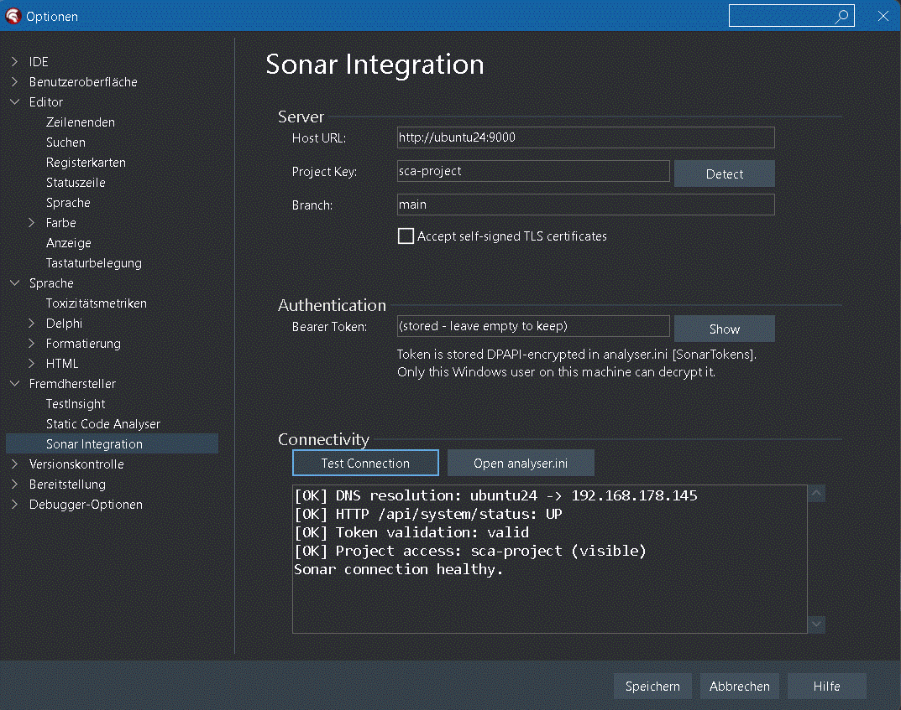

# SonarQube Integration — Setup Guide

StaticCodeAnalyser kann seine Findings als **external issues** an SonarQube /
SonarCloud liefern. Wir konkurrieren nicht mit
[SonarDelphi](https://github.com/integrated-application-development/sonar-delphi) —
unsere Findings (mORMot-Leaks, DFM-Detektoren, sonarfremde Smells wie
`ConcatToFormat` / `TautologicalBoolExpr`) ergänzen den SonarDelphi-Report.
SonarDelphi ist dabei optional: SCA-Findings kommen auch ohne das Plugin ins
Projekt.

---

## Quick start (lokaler Sonar via Docker)

```powershell
# 1. Sonar starten (siehe sonar-docker-Test.md falls vorhanden)
docker run -d --name sonarqube -p 9000:9000 sonarqube:latest

# 2. Token in Sonar erstellen (Web-UI: User > My Account > Security)

# 3. SCA konfigurieren — entweder Tools>Options im IDE-Plugin
#    oder direkt CLI:
analyser.exe --sonar-test `
  --sonar-host http://localhost:9000 `
  --sonar-token squ_xxxxx `
  --sonar-project my-delphi-project

# 4. sonar-project.properties Template ablegen
analyser.exe --sonar-init --path .

# 5. Analyse + Export
analyser.exe --path . --full --sonar-export sca-findings.json

# 6. Scanner laufen lassen
sonar-scanner
```

Im Sonar-Dashboard erscheinen die SCA-Findings unter Issues als
`external_static-code-analyser:SCA<NNN>`, neben den SonarDelphi-Findings,
falls das Plugin mitläuft.

Ohne `sonar-project.properties` und ohne SonarDelphi geht es über
`sonar-upload.ps1`, siehe [Sonar-Projekt einrichten](#sonar-projekt-einrichten).

---

## Konfigurations-Quellen (Priorität)

Vier Quellen, höchste Priorität zuerst — jede Quelle füllt nur Felder die
noch leer sind:

| # | Quelle | Standalone | IDE-Plugin |
|---|---|---|---|
| 1 | CLI-Flags (`--sonar-host`, `--sonar-token`, ...) | ✅ | — |
| 2 | Env-Vars (`SONAR_HOST_URL`, `SONAR_TOKEN`, `SONAR_PROJECT_KEY`, ...) | ✅ | ✅ |
| 3 | Project-Config (`sonar-project.properties` im `--path`) | ✅ | ✅ |
| 4 | User-INI (`%APPDATA%\StaticCodeAnalyser\analyser.ini` `[Sonar]` + `[SonarTokens]`) | ✅ | ✅ |

Token-Speicherung in der INI: **DPAPI-verschlüsselt** (Windows, Current-User-
Scope). Die Datei ist damit an dieses Windows-Konto gebunden — eine Kopie ist
auf einem anderen Rechner wertlos. Das ist Schutz der *ruhenden Datei*, kein
Tresor: jedes Programm, das unter demselben Konto läuft, kann ebenso
entschlüsseln. Wer das nicht will, nimmt `SONAR_TOKEN` aus der Umgebung.

Auf Non-Windows schreibt das Werkzeug den Token mit `PT:`-Präfix als
Base64 — **unverschlüsselt**. Gelesen werden solche Einträge auf *jeder*
Plattform, also auch unter Windows, wenn man eine INI mitbringt. In dem Fall
warnt `--sonar-test` auf stderr und die Options-Seite der IDE tauscht ihren
DPAPI-Hinweis gegen eine Warnung aus.

### Beispiel `analyser.ini` (Sonar-Section)

```ini
[Sonar]
HostUrl=http://localhost:9000
ProjectKey=my-delphi-project
Branch=
Organization=
Insecure=0
TokenRef=ide-default

[SonarTokens]
; Werte sind DPAPI-Hex (Windows). CLI-/Env-Override umgeht diese Section.
ide-default=01000000d08c9ddf0115d1118c7a00c04fc297eb...
```

### Beispiel `sonar-project.properties` (im Projekt-Root)

```properties
sonar.projectKey=my-delphi-project
sonar.projectName=My Delphi Project
sonar.sources=.
sonar.sourceEncoding=UTF-8
sonar.exclusions=**/*.dcu,**/*.bpl,**/lib/**,**/Win32/**,**/Win64/**

# SCA findings als external issues (Generic Issue Format)
sonar.externalIssuesReportPaths=sca-findings.json
```

---

## CLI Reference

| Flag | Zweck |
|---|---|
| `--sonar-export <file>` | Analyse-Output als Generic Issue JSON schreiben |
| `--sonar-init` | `sonar-project.properties`-Template anlegen (überschreibt nie: weicht auf `.sample` aus und bricht ab, wenn auch die abweicht) |
| `--sonar-test` | Connectivity-Health-Check (DNS → Status → Token → Project) |
| `--sonar-host <url>` | Server-URL überschreiben |
| `--sonar-token <tok>` | Bearer-Token überschreiben (Vorsicht: shell history) |
| `--sonar-project <key>` | Project-Key überschreiben |
| `--sonar-branch <name>` | Branch-Name für das `--sonar-init`-Template (`sonar.branch.name`). Der Findings-Export hat kein Branch-Feld — den Branch liest der `sonar-scanner` |
| `--sonar-insecure` | Self-signed TLS-Cert akzeptieren |
| `--sonar-keep-downgraded` | Auch Funde exportieren, deren Severity per Pfad-Überschreibung **herabgestuft** wurde (der Konfidenz-Deckel zählt nicht dazu). Standard: aus — siehe Kasten unten |
| `--sonar-config <ini>` | Alternativer `analyser.ini`-Pfad |

`--sonar-test` und `--sonar-init` sind **Standalone-Aktionen** und brauchen
weder `--path` noch `--file`.

### Herabgestufte Funde und Sonar

Das Generic Issue Format kennt eine Severity nur **je Regel**, nicht je Fund.
Wer also per Pfad-Überschreibung festlegt „in generiertem Code ist das nur
ein Hinweis", bekommt diesen Fund in Sonar trotzdem in voller
Katalog-Schwere zu sehen — und das Quality Gate reißt.

Deshalb exportiert der Analyser herabgestufte Funde standardmäßig **gar
nicht**: lieber nicht melden als falsch melden. In SARIF, HTML, CSV, JSON und
in der Konsolenausgabe bleiben sie vollständig erhalten.

**Hoch**gestufte Funde sind nie betroffen — sie gehen immer in den Report
(mit der Katalog-Schwere, mehr gibt das Format nicht her).

**Custom-Regeln** (`--custom-rules`): ihre Severity steht in der YAML-Regel
selbst und ist der Maßstab – auch `severity: hint` gilt nicht als
herabgestuft. Herabgestuft ist ein Custom-Fund nur, wenn eine
Pfad-Überschreibung ihn unter seine YAML-Severity setzt; dann bleibt er wie
jeder andere draußen. Jede Custom-Regel erscheint in Sonar
unter eigenem Namen („User-defined custom rule PROJ001“) mit einem Impact nach
ihrer YAML-Severity (error → HIGH, warning → MEDIUM, hint → LOW).

**Konfidenz-Deckel ist keine Herabstufung:** die Evidenz-Politik deckelt
Funde mit Konfidenz *medium* auf Warning (*low* auf Hint). Das zählt nicht
als Herabstufung — solche Funde gehen in den Report. Bis Oktober 2026 galten
sie als herabgestuft und fehlten: im Realwelt-Korpus 726 Funde, u. a. fast
alle von SCA001, SCA003 und SCA004. Eine Regel, deren Funde die Politik
schon mit der Standard-Konfidenz des Kinds deckelt, trägt in Sonar die
gedeckelte Schwere als Impact (Warning → höchstens MEDIUM): SCA004 kommt als
SECURITY/MEDIUM statt BLOCKER an. Mit `[Rules] EvidenceTiering=0` bleiben die
Katalog-Impacts.

Mit `--sonar-keep-downgraded` lässt sich das umstellen. Zu bedenken: was
einmal im Report stand und künftig fehlt, zählt SonarQube als *behoben*, und
umgekehrt zählt Neuauftauchendes als *neuer* Fund mit heutigem Datum — das
trifft die New-Code-Periode. Der Schalter sollte also einmal gesetzt und
dann nicht mehr gewechselt werden.

### Beispiel Health-Check-Output

```
Sonar config:
  host    = http://localhost:9000   (CLI --sonar-host)
  project = my-delphi-project       (analyser.ini)
  token   = (42 chars from env SONAR_TOKEN)

[OK]   DNS resolution: localhost -> 127.0.0.1
[OK]   HTTP /api/system/status: UP
[OK]   Token validation: valid
[OK]   Project access: my-delphi-project (visible)
Sonar connection healthy.
```

Exit-Code: `0` = healthy, `99` = irgendeine Stufe fehlgeschlagen.

---

## CI/CD-Setups

### GitHub Actions

```yaml
env:
  SONAR_HOST_URL: ${{ secrets.SONAR_HOST_URL }}
  SONAR_TOKEN:    ${{ secrets.SONAR_TOKEN }}
  SONAR_PROJECT_KEY: my-delphi-project
steps:
  - uses: actions/checkout@v4
  - name: Run StaticCodeAnalyser
    run: analyser.exe --path . --full --sonar-export sca-findings.json
  - name: Run sonar-scanner
    uses: SonarSource/sonarcloud-github-action@master
```

### Azure DevOps Pipeline

```yaml
variables:
  SONAR_HOST_URL: $(SonarHostUrl)
  SONAR_TOKEN:    $(SonarToken)
- script: analyser.exe --path $(Build.SourcesDirectory) --full --sonar-export sca-findings.json
- task: SonarCloudPrepare@2
- task: SonarCloudAnalyze@2
- task: SonarCloudPublish@2
```

---

## IDE Plugin

### Tools > Options > Third Party > Sonar Integration

Eine eigene Options-Page mit Host / Project / Token / Branch + Insecure-
Checkbox. **Detect**-Button liest `sonar-project.properties` aus dem
aktuell offenen Projekt. **Test Connection** läuft denselben Health-Check
wie das CLI `--sonar-test` und zeigt das Ergebnis als Checkliste.



### "Sonar: write Generic Issue report (all findings)..." im Export-Menü

Dieser Menüeintrag ist zwischen IDE-Plugin und Standalone-EXE geteilt
(`SCA.SharedUI`) — er verhält sich in beiden identisch.

Schreibt **alle** Findings der Analyse als eine `sca-findings.json` in
einen vom User gewählten Pfad. Die Filter im Findings-Grid
(Severity-Combo, Typ-Combo, Suchfeld) und ein aktiver Baseline-Filter
wirken **nicht** — der Report hat denselben Umfang wie das CLI
`--sonar-export`. Wer nur eine Teilmenge nach Sonar geben will, nimmt
„Sonar: send selected as external issue" (nächster Abschnitt); der
Eintrag arbeitet selektionsbasiert.

Dass der Report mehr Einträge hat als das Grid gerade zeigt, ist so
gewollt: ein Sonar-Push soll den Projektzustand abbilden, nicht die
Ansichtseinstellung des Bedieners. Bis Mai 2026 wurde die gefilterte
Sicht exportiert — wer nach „Errors" gefiltert hatte, schickte
stillschweigend nur die Errors nach Sonar.

### "Sonar: send selected as external issue"

Multi-Select-fähig. Schreibt pro Finding eine JSON-Datei nach
`<repo>\.sonar\external\<severity>-<file>-L<line>-<hash>.json`. Sonar-Scanner
sammelt die automatisch via:

```properties
sonar.externalIssuesReportPaths=.sonar/external/
```

---

## Sonar-Projekt einrichten

Der Weg für SCA-Findings in ein neues SonarQube-Projekt, von oben nach unten
abzuarbeiten. Er nutzt `sonar-upload.ps1` und läuft ohne das Java-Plugin
SonarDelphi.

1. **Voraussetzungen prüfen.** Der Server ist erreichbar und
   `<host>/api/system/status` meldet `UP`. `sonar-scanner` ist installiert,
   siehe `sonarHowto.md`, Abschnitt 0.1.

2. **Projekt anlegen.** Im Web-UI *Create Project* → *manually*. Der Key muss
   dem `ProjectKey` in der SCA-Konfiguration entsprechen. In den Project
   Settings auf dem Server sind für diesen Weg keine Einträge nötig.

3. **Token erzeugen.** Unter *My Account* → *Security* einen **User Token**
   (`squ_...`) generieren. Der Name muss je Benutzer eindeutig sein, der Wert
   wird nur einmal angezeigt. Badge-Token (`sqb_...` aus *Project Information*)
   taugen nicht für Analysen; `--sonar-test` meldet damit `{"valid":false}`.

4. **SCA konfigurieren.** Auf der
   [Options-Seite](#tools--options--third-party--sonar-integration) Host,
   Project Key und Bearer Token eintragen. Steht im Token-Feld der Platzhalter
   oder ist es leer, bleibt der alte Token erhalten: zum Ersetzen das Feld
   leeren und den neuen Wert einfügen. `sonar-upload.ps1` nimmt wie das
   Werkzeug zuerst `SONAR_HOST_URL`, `SONAR_PROJECT_KEY` und `SONAR_TOKEN` aus
   der Umgebung und für alles Übrige die `analyser.ini`.

5. **Verbindung testen.** `analyser.exe --sonar-test` muss alle Stufen mit
   `[OK]` und am Ende `Sonar connection healthy.` melden, siehe
   [Beispiel-Output](#beispiel-health-check-output).

6. **Report schreiben.** Analyse laufen lassen, dann im Export-Menü
   [„Sonar: write Generic Issue report (all findings)..."](#sonar-write-generic-issue-report-all-findings-im-export-menü)
   wählen. Der Eintrag schreibt nur eine Datei und sendet nichts.

7. **Hochladen.** Im SCA-Repo in `cmd` zuerst als Probelauf, dann ohne `-DryRun`:

   ```cmd
   StaticCodeAnalyserForm\scripts\sonar-upload.cmd -ProjectPath <analyse-ordner> -JsonPath <analyse-ordner>\sca-findings.json -DryRun
   StaticCodeAnalyserForm\scripts\sonar-upload.cmd -ProjectPath <analyse-ordner> -JsonPath <analyse-ordner>\sca-findings.json
   ```

   **`-ProjectPath` muss der Ordner sein, über den die Analyse lief.** Die Pfade
   im Report sind relativ zu diesem Ordner. Existiert keiner davon, bricht das
   Skript vor dem Scan ab; existiert nur ein Teil, warnt es und läuft weiter.
   `-JsonPath` ist nötig, wenn der Report nicht als `sca-findings.json` im
   `-ProjectPath` liegt.

   Die `.cmd` setzt `-DisableDelphi`. SonarDelphi läuft also nicht mit und
   braucht keine Einstellungen.

8. **Ergebnis prüfen.** `Upload complete` beweist keinen Import. Entscheidend
   sind diese Zeilen im Scanner-Log:

   ```
   Imported N issues in M files
   External issues ignored for N unknown files, including: ...
   ```

   Danach verarbeitet der Server die Analyse noch kurz im Hintergrund, erst dann
   erscheinen die Issues im Dashboard.

### Grenzen

- **Ein Project Key je Analyse-Ordner.** Das Skript nimmt den Key immer aus der
  INI. Eine Analyse aus einem anderen Ordner ersetzt den Stand im Projekt.
- **Oberordner.** Wird ein Oberordner analysiert, landet auch der Quellcode aller
  Unterprojekte im Sonar-Projekt.
- **Ausschlüsse.** Die Standard-Ausschlüsse von `sonar-upload.ps1`
  (`**/lib/**`, `**/DUnitX-*/**` usw.) verwerfen Findings in diesen Pfaden.
- **Eingebettete Git-Repos.** Beobachtung aus einem Testlauf über einen
  Oberordner: Findings aus drei eingebetteten Repos wurden nicht importiert, die
  aus einem als Submodul eingebundenen Repo schon. Die Ursache ist nicht
  bestätigt.

---

## MQR (Multi-Quality-Rating)

Jede SCA-Rule trägt im Catalog [`rules/sca-rules.json`](../rules/sca-rules.json):
- **`cleanCodeAttribute`** — `LAWFUL` / `LOGICAL` / `FOCUSED` / ... (14-Wert-Enum)
- **`impacts[]`** — `{ softwareQuality, severity }` mit
  `softwareQuality ∈ {SECURITY, RELIABILITY, MAINTAINABILITY}` und
  `severity ∈ {BLOCKER, HIGH, MEDIUM, LOW, INFO}`

**Mindestversion:** `BLOCKER` und `INFO` als Impact-Severity kennt SonarQube
erst ab **10.8** (Server 2025.x, Community Build 24.12+). 10.3 bis 10.7
erlauben laut Spezifikation nur `HIGH`/`MEDIUM`/`LOW`; ein Report mit
`BLOCKER`/`INFO` ist dort ungültig (zu erwarten: der Scanner verwirft ihn
ganz, am Server noch nicht beobachtet). Vor 10.3 versteht Sonar das Format mit
`rules[]` gar nicht.

Diese Felder landen automatisch in der Generic-Issue-Output. Sonar nutzt sie
für das MQR-Dashboard. Beispiele:

| Rule | cleanCodeAttribute | impact |
|---|---|---|
| SCA001 MemoryLeak | LAWFUL | RELIABILITY/HIGH |
| SCA003 SQLInjection | LAWFUL | SECURITY/HIGH |
| SCA004 HardcodedSecret | LAWFUL | SECURITY/BLOCKER |
| SCA012 LongMethod | FOCUSED | MAINTAINABILITY/MEDIUM |
| SCA014 MagicNumber | CLEAR | MAINTAINABILITY/LOW |

Volle Tabelle in [`docs/rules.md`](rules.md).

---

## Troubleshooting

**`[FAIL] HTTP /api/system/status: 503 Service Unavailable`** — Sonar-Server
fährt hoch. ~60s warten und retry.

**`[FAIL] Token validation: 401 Unauthorized`** — Token rejected. Token im
Web-UI rotieren (User > My Account > Security > Generate Tokens), neuen Wert
in der INI / Env oder per CLI setzen.

**`[FAIL] Token validation: 200` mit `{"valid":false}`** — Der Server akzeptiert
den Token nicht, nennt aber keinen Grund. Möglich sind ein Badge-Token
(`sqb_...`) oder ein Wert, den dieser Server nicht (mehr) kennt. Neuen User
Token erzeugen und in den IDE-Optionen das Token-Feld erst leeren, sonst bleibt
der alte Wert stehen.

**`[FAIL] Project access: not found`** — Project existiert nicht oder Token
hat keine Browse-Permission. Anlegen via Web-UI oder per API:

```powershell
curl -u $env:SONAR_TOKEN: -X POST `
  "$env:SONAR_HOST_URL/api/projects/create?project=my-delphi-project&name=My+Delphi+Project"
```

**`Imported 0 issues` oder `External issues ignored for N unknown files`** —
Sonar findet die Dateien aus dem Report nicht im Scan-Ordner. Der Scanner muss
in dem Ordner laufen, über den die Analyse lief (`sonar-upload.ps1 -ProjectPath`,
siehe [Sonar-Projekt einrichten](#sonar-projekt-einrichten)). Einzelne Dateien
fallen außerdem durch Ausschlüsse weg, siehe [Grenzen](#grenzen).

**`Path to Delphi standardlibrary is invalid`** — Das Java-Plugin SonarDelphi
sucht die Delphi-Standardbibliothek und bricht den Scanner ab. Ohne Angabe nimmt
es `C:\Program Files (x86)\Embarcadero\Studio\22.0` und `VER350`. Entweder ohne
Plugin hochladen (`sonar-upload.ps1 -DisableDelphi`, die `sonar-upload.cmd` setzt
das schon) oder `sonar.delphi.installationPath` und
`sonar.delphi.compilerVersion` auf die installierte Delphi-Version setzen.

**SARIF + Sonar-Generic gleichzeitig** — Sonar dedupliziert die beiden nicht.
Genau **ein** Report-Format auswählen (entweder
`sonar.externalIssuesReportPaths` oder `sonar.sarifReportPaths`).

**`--sonar-token` in der Shell-History** — sicherheits-kritisch. Lieber Env-Var
oder DPAPI-INI nutzen; das CLI-Flag ist für einmalige Tests / CI-Pipelines.

---

## Roadmap-Status

Diese Implementierung deckt **todo-sonar.md Phase 0 + A + B + C + D**:
- ✅ Konfigurations-Layer (CLI/Env/Properties/INI Resolver, DPAPI-Token-Storage)
- ✅ Health-Check (`--sonar-test`)
- ✅ Generic Issue Export (`--sonar-export`)
- ✅ Project-Properties-Template (`--sonar-init`)
- ✅ Tools>Options Sonar-Seite
- ✅ Send-to-Sonar im Export-Menü (Bulk + per-Issue): schreibt nur Dateien, der
  Upload läuft separat über `sonar-scanner` bzw. `sonar-upload.ps1`
- ❌ Pull-Mode für IDE — **nicht Teil des Produkts**. Die Engine (`uSonarPull`)
  war seit v0.9.1 implementiert, bekam nie eine UI-Anbindung und wurde 2026-08
  entfernt; sie steckte als ausgehender HTTP-Client mit Bearer-Token in jeder
  BPL, ohne Aufrufer. In der Git-Historie erhalten
- ✅ MQR-Mapping pro Rule (cleanCodeAttribute + impacts)
